<div align="center">

# FlowForge

**Orchestrate · Execute · Observe**

A self-hosted distributed task queue and workflow engine. Submit background jobs through a REST API or a Python SDK,
run them on a pool of custom workers with retries, priorities, delays, cron schedules and DAG workflows, and watch
everything live in a dashboard.


</div>

PostgreSQL is the source of truth, and Redis Streams only carry dispatches. Workers hold fenced leases, so a crash, a
network partition or a Redis restart delays work but never loses it. Those claims are tested by killing real processes
and cutting real network connections, not with mocks.

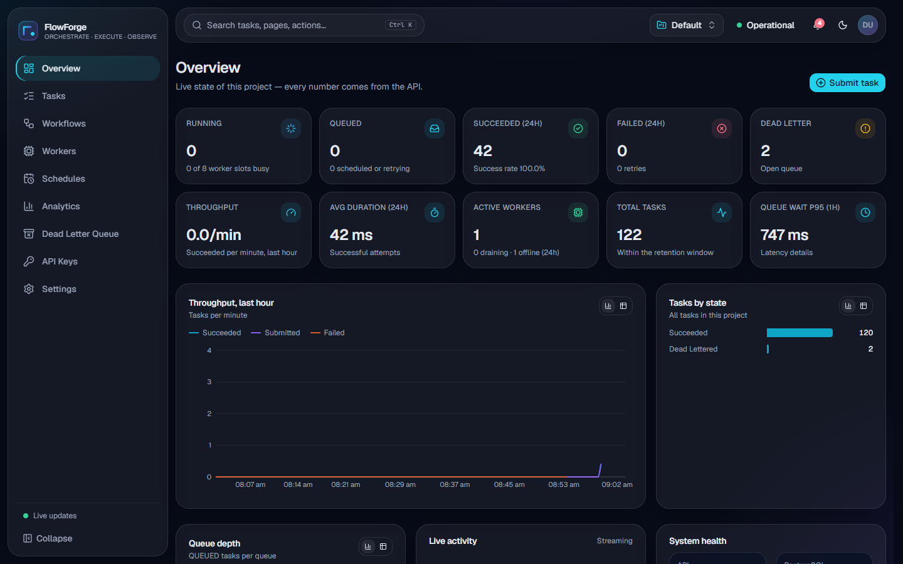

<table>
  <tr>
    <td>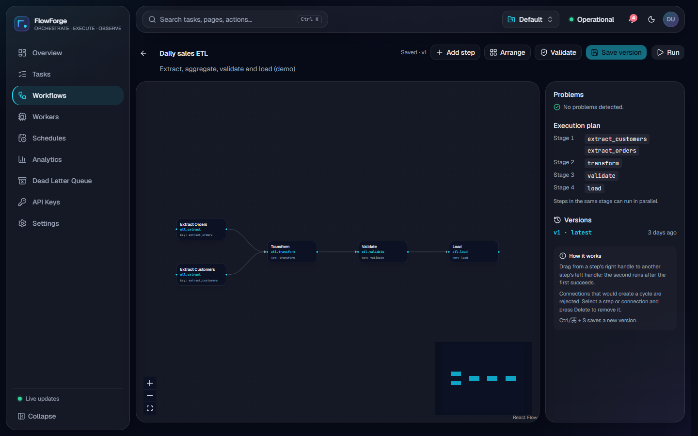</td>
    <td>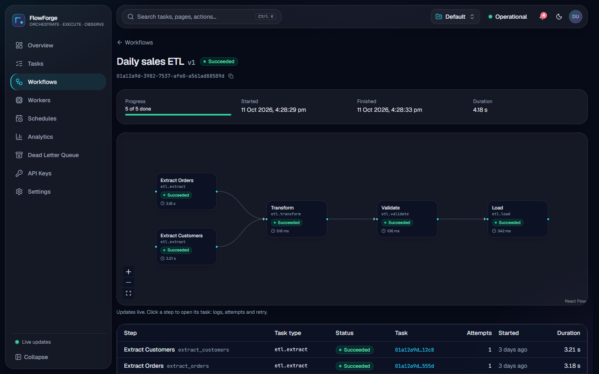</td>
  </tr>
  <tr>
    <td align="center"><sub>Workflow builder: drag steps, connect them, cycles are refused</sub></td>
    <td align="center"><sub>A workflow run, live</sub></td>
  </tr>
  <tr>
    <td>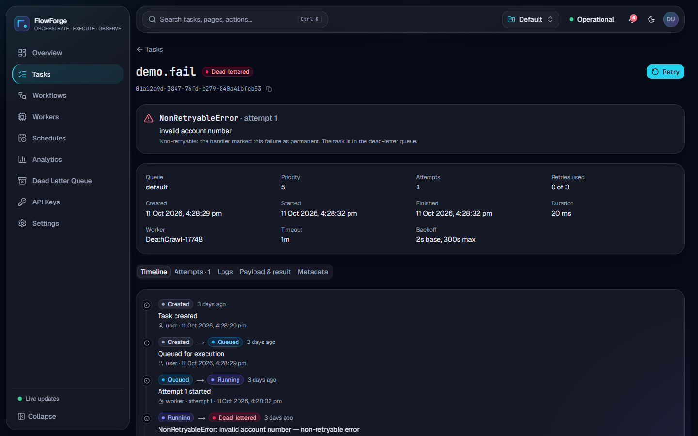</td>
    <td>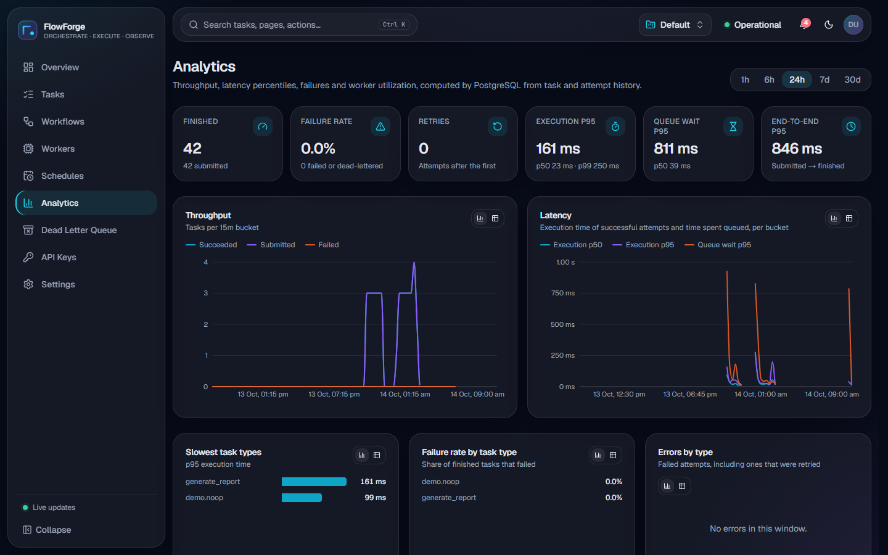</td>
  </tr>
  <tr>
    <td align="center"><sub>Task detail: timeline, attempts, live logs</sub></td>
    <td align="center"><sub>Analytics: throughput, latency, failures, utilization</sub></td>
  </tr>
</table>

<details>
<summary><b>More screenshots</b> (tasks, workers, schedules, dead-letter queue, workflows, settings)</summary>

| | |
|---|---|
| 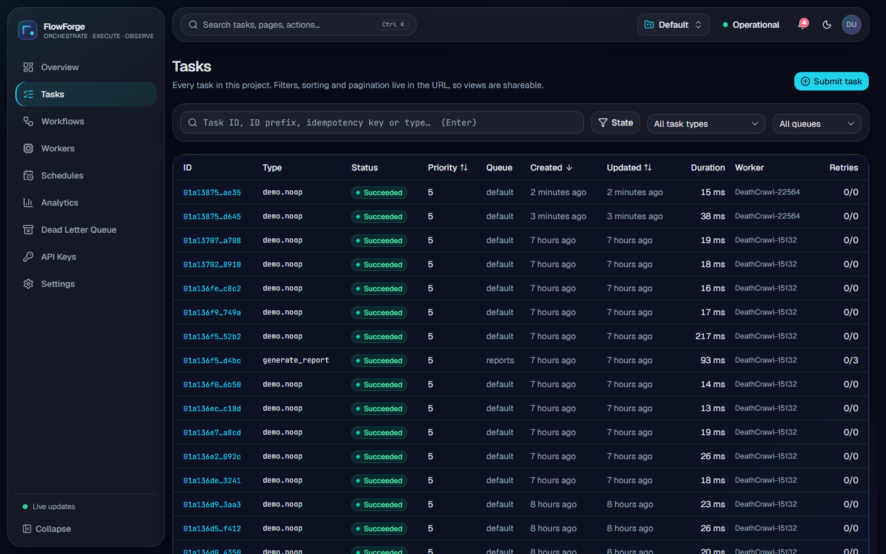 | 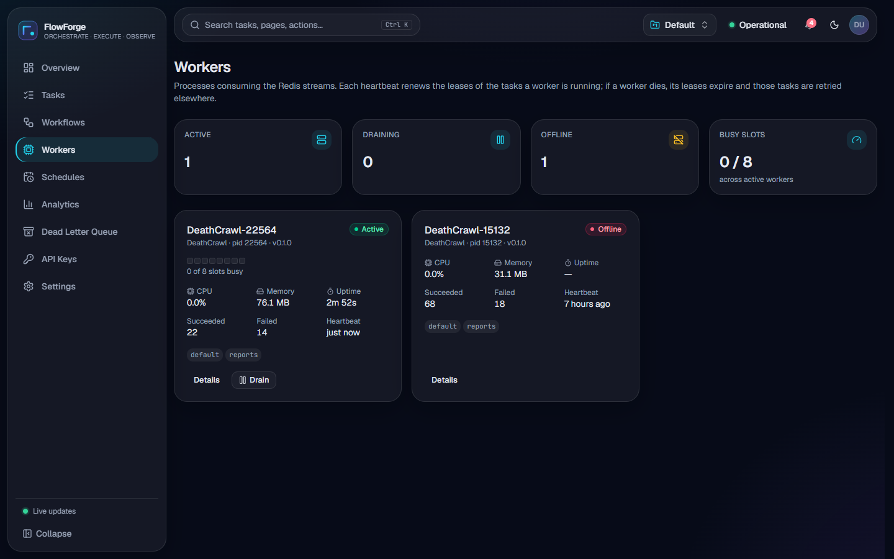 |
| Task explorer with filters kept in the URL | Worker fleet: slots, CPU, memory, heartbeats |
| 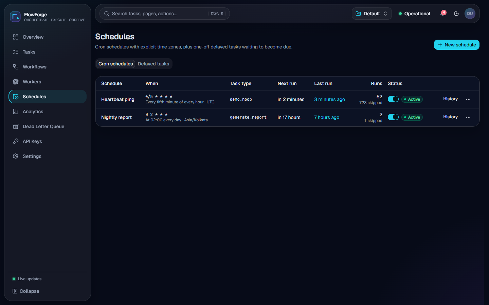 | 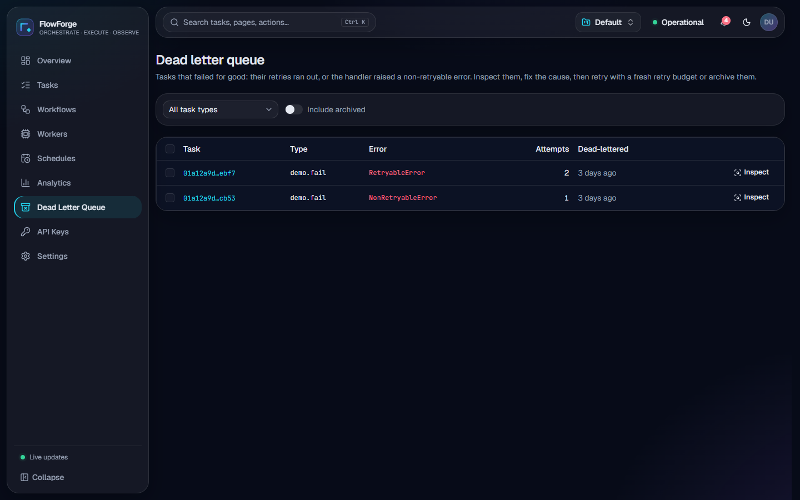 |
| Cron schedules with time zones and previews | Dead-letter queue with bulk retry and archive |
| 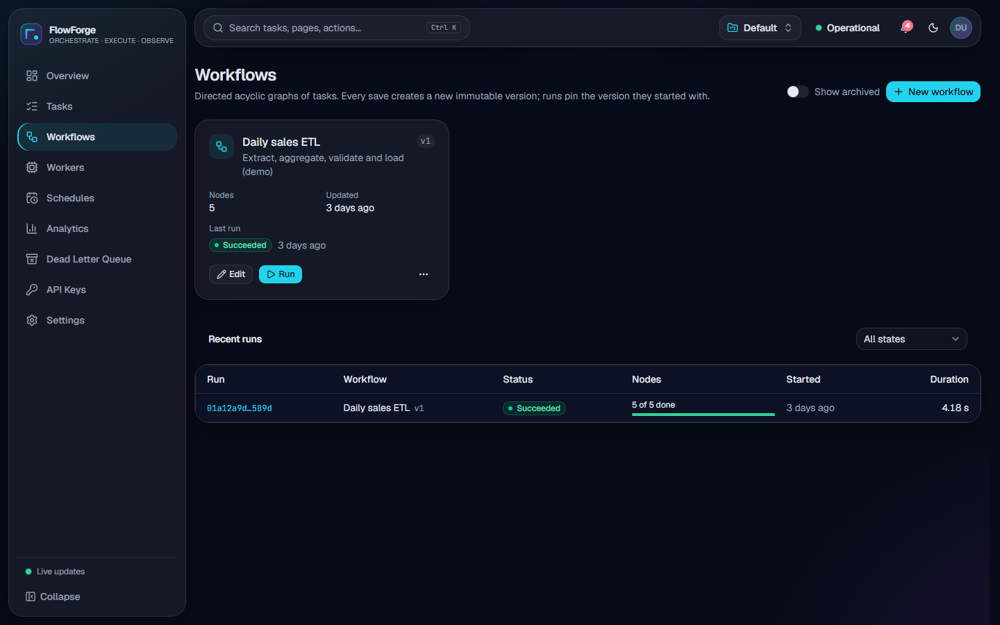 | 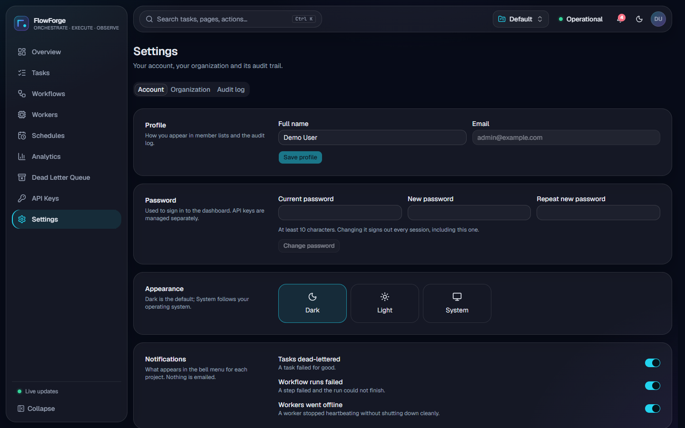 |
| Workflows with recent runs | Organization, members, roles and audit log |

</details>

Every screenshot shows the real application with real data, captured by
[`tests/e2e/specs/screenshots.spec.ts`](tests/e2e/specs/screenshots.spec.ts).

---

## Contents

1. [Project at a glance](#project-at-a-glance)
2. [Features](#features)
3. [Architecture](#architecture)
4. [How a task runs](#how-a-task-runs)
5. [Priorities, retries and the dead-letter queue](#priorities-retries-and-the-dead-letter-queue)
6. [Workflows (DAGs)](#workflows-dags)
7. [Cron schedules](#cron-schedules)
8. [Realtime updates](#realtime-updates)
9. [Reliability model](#reliability-model)
10. [Data model](#data-model)
11. [Security](#security)
12. [Observability](#observability)
13. [The dashboard](#the-dashboard)
14. [Getting started](#getting-started)
15. [Configuration](#configuration)
16. [Using the API](#using-the-api)
17. [Python SDK](#python-sdk)
18. [Writing task handlers](#writing-task-handlers)
19. [Command-line tools](#command-line-tools)
20. [Performance and benchmarks](#performance-and-benchmarks)
21. [Testing](#testing)
22. [Continuous integration](#continuous-integration)
23. [Repository layout](#repository-layout)
24. [Deployment and operations](#deployment-and-operations)
25. [Architecture decision records](#architecture-decision-records)
26. [Limitations and known issues](#limitations-and-known-issues)
27. [Roadmap](#roadmap)
28. [Documentation index](#documentation-index)

---

## Project at a glance

| | |
|---|---|
| **Delivery guarantee** | At-least-once execution with exactly-once state transitions. Handlers must be idempotent ([ADR 0004](docs/decisions/0004-at-least-once-delivery.md)) |
| **Source of truth** | PostgreSQL 18: 22 tables, a state machine enforced by a trigger, `SKIP LOCKED` work partitioning, `LISTEN/NOTIFY` |
| **Dispatch channel** | Redis 8 Streams: three priority bands per queue, consumer groups, `XAUTOCLAIM` reclaim |
| **Processes** | API, worker, scheduler (control plane) and dashboard. One backend image runs any of the first three |
| **API surface** | 72 operations on 60 paths, OpenAPI document committed at [`packages/shared-schemas/openapi.json`](packages/shared-schemas/openapi.json) |
| **Code size** | About 12,400 lines of Python in 87 source files, and 9,700 lines of hand-written TypeScript |
| **Tests** | 442 Python tests (88.8% branch coverage), 5 chaos tests, 57 dashboard tests, 15 browser tests |
| **Measured throughput** | 143 no-op tasks/s on one worker process, 438 tasks/s on eight (one laptop, see [benchmarks](#performance-and-benchmarks)) |
| **Design records** | 12 architecture decision records in [`docs/decisions`](docs/decisions/README.md) |

---

## Features

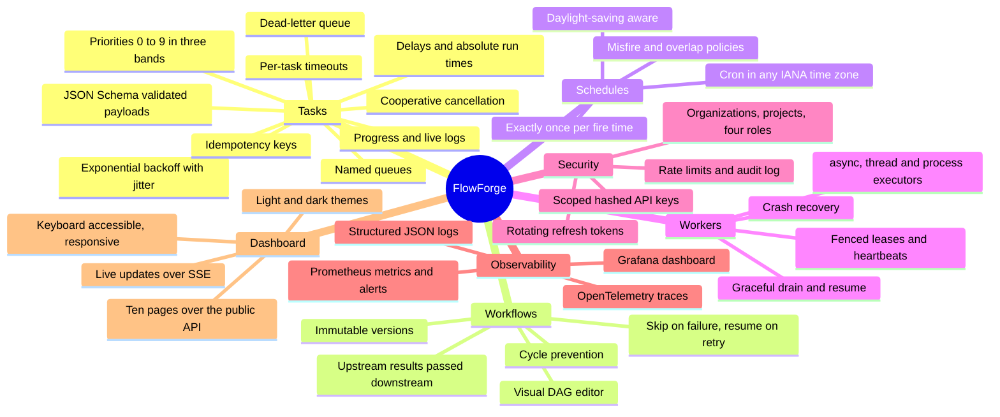

**Tasks.** Typed handlers with payloads validated against a JSON Schema before they are stored; priorities 0–9 mapped
to three starvation-free bands; named queues; delays (`delay_seconds`) and absolute run times (`run_at`); per-task
timeouts; retries with exponential backoff and equal jitter; a dead-letter queue with manual and bulk retry;
idempotency keys on every submission; atomic batch submission of up to 1,000 tasks; cooperative cancellation;
progress reporting; per-attempt logs streamed live to the browser.

**Workflows.** DAGs built in a visual editor that refuses cycles and shows the offending path. Each save creates an
immutable version, and every run pins the version it started with. A step starts when all of its upstream steps
succeed, and it receives the run input and the results of its direct parents. A failed step skips only its own
descendants, and retrying it resumes the run.

**Schedules.** Cron expressions in any IANA time zone, correct across daylight-saving changes, with a live preview of
the next five runs and warnings about upcoming clock changes. Each fire time runs exactly once across any number of
scheduler replicas, with per-schedule misfire and overlap policies.

**Workers.** A custom asyncio runtime with `async`, `thread` and `process` executors; heartbeats that renew leases;
automatic recovery of tasks from crashed workers; fenced writes so a presumed-dead worker cannot overwrite newer
results; graceful drain and resume; CPU and memory reporting.

**Security.** Organizations, projects and four roles (owner, admin, developer, viewer); strict tenant isolation, where
another tenant's resource answers `404`; 15-minute JWTs with rotating refresh cookies and theft detection; scoped,
rotatable, hashed API keys; Argon2id passwords with account lockout; Redis-backed rate limiting; an audit log written
in the same transaction as each change; security headers.

**Observability.** Prometheus metrics from every process, eight alert rules, a provisioned Grafana dashboard,
OpenTelemetry traces that follow a task from submission through the stream to the worker, structured JSON logs with
secret redaction, and analytics in the dashboard.

**Dashboard.** Ten pages over the public API: overview, task explorer and task detail, workflows (editor and live
runs), workers, schedules, analytics, dead-letter queue, API keys and settings. Live updates over SSE, a command
palette (`Ctrl+K`), keyboard and screen-reader support, mobile layouts, light and dark themes.

---

## Architecture

FlowForge is a **modular monolith**: a few process types that share one PostgreSQL database and one Redis, all
importing the same domain packages. There are no microservices and no distributed transactions. Each process type
scales horizontally on its own ([ADR 0010](docs/decisions/0010-modular-monolith.md)).

### System overview

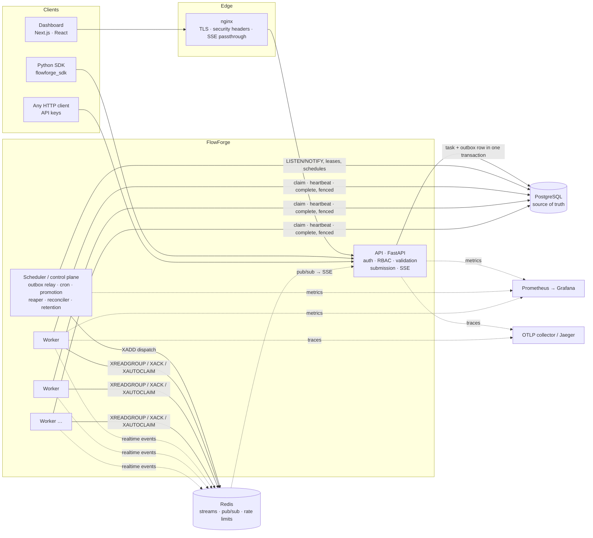

### Processes

| Process | Command | Responsibilities | Scaling |
|---|---|---|---|
| **API** | `flowforge-api` | Authentication (JWT + rotating refresh cookie, API keys), RBAC and tenant isolation, payload validation against each task type's JSON Schema, submission (task + outbox row in one transaction), queries, analytics, SSE fan-out | Stateless; any number of replicas |
| **Worker** | `flowforge-worker` | Reads its queues' streams by priority band, claims tasks with a fenced lease, runs handlers, heartbeats, records completion and failure, writes task logs, cooperative cancellation, graceful drain | Any number; each has `worker_concurrency` slots (default 8) |
| **Scheduler** | `flowforge-scheduler` | Outbox relay, promotion of delayed and retrying tasks, cron firing, lease reaper, offline-worker detection, reconciler, retention, queue metrics | Any number of active-active replicas; work is partitioned with `FOR UPDATE SKIP LOCKED`, no leader election |
| **Dashboard** | `node server.js` | The web UI, which uses only the public API; live updates through SSE | Static assets plus a Node server |
| **Admin CLI** | `flowforge-admin` | Migrations, platform admins, password resets | Run on demand |

### Package layering

The Python code is a [uv](https://docs.astral.sh/uv/) workspace. Shared invariants (the state machine, retry math,
RBAC, DAG validation, cron) live in a pure package with no I/O and are unit-tested without any services.

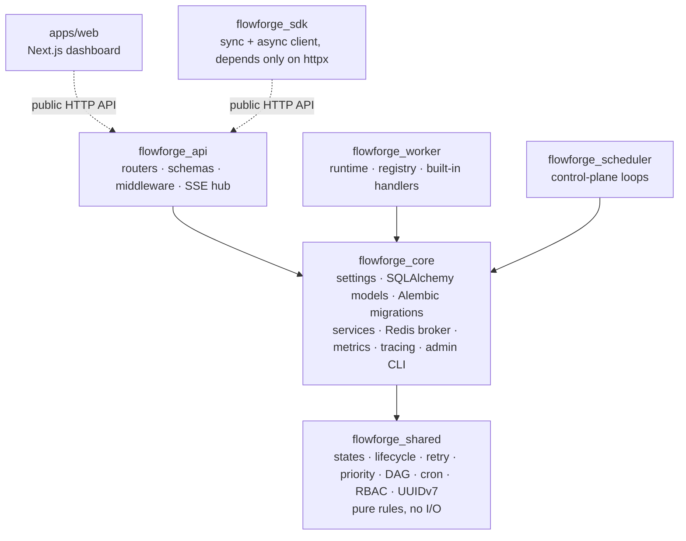

### Deployment topology (Docker Compose)

Only nginx publishes a port. PostgreSQL, Redis and the metrics endpoints stay on the internal network, and the
optional observability UIs bind to `127.0.0.1`.

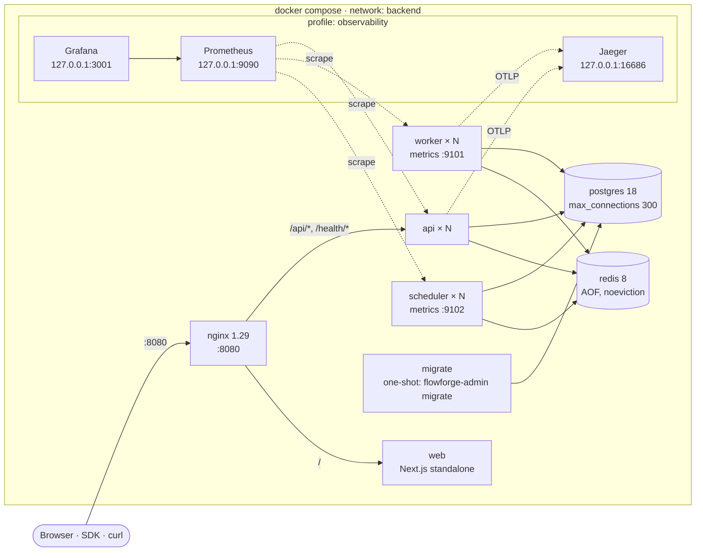

The `migrate` service applies migrations and exits; the API, workers and scheduler wait for it to finish. Workers get
a 45-second stop grace period so running tasks can finish or be handed back on `docker compose stop`.

### Technology stack

| Layer | Stack |
|---|---|
| API | Python 3.12, FastAPI, Pydantic 2, SQLAlchemy 2 (asyncpg), Alembic, PyJWT (HS256), argon2-cffi (Argon2id), uvicorn |
| Workers and scheduler | asyncio, redis-py (Streams, consumer groups, `XAUTOCLAIM`, pub/sub), asyncpg `LISTEN`, cronsim, psutil |
| Storage | PostgreSQL 18 (triggers, partial indexes, `SKIP LOCKED`, `LISTEN/NOTIFY`), Redis 8 |
| Dashboard | Next.js 16, React 19, TypeScript, Tailwind CSS 4, shadcn/ui (Radix), TanStack Query, React Flow (`@xyflow/react`), Recharts, Zustand, React Hook Form + Zod |
| Observability | prometheus-client, OpenTelemetry, structlog, Prometheus 3, Grafana 12, Jaeger 2 |
| Tooling | uv workspace, ruff, mypy (strict), pytest, Vitest, Playwright, Locust, bandit, pip-audit, GitHub Actions, Docker Compose |

---

## How a task runs

### Every path into a queue goes through the outbox

Writing the task row and then calling `XADD` would be a dual write: a crash between the two leaves a task nobody runs,
or a stream entry for a task that was rolled back. So every state change that needs a dispatch writes an
`outbox_events` row **in the same transaction**, and the scheduler's relay publishes it
([ADR 0002](docs/decisions/0002-transactional-outbox.md)).

```mermaid
flowchart LR
    subgraph sources["Dispatch reasons"]
        s1["submit<br/>API, SDK, batch"]
        s2["delay_elapsed<br/>promoter"]
        s3["retry<br/>backoff elapsed"]
        s4["manual_retry<br/>task or DLQ retry"]
        s5["schedule<br/>cron fire"]
        s6["workflow<br/>parents succeeded"]
        s7["reconcile<br/>stream entry lost"]
    end
    tx["same PostgreSQL transaction<br/>as the state change"]
    ob[("outbox_events<br/>published_at IS NULL")]
    relay["scheduler relay<br/>woken by pg_notify ff_outbox<br/>1 s polling fallback"]
    rs[("ff:q:queue:band<br/>Redis stream")]

    sources --> tx --> ob
    ob -->|"lock rows FOR UPDATE SKIP LOCKED"| relay
    relay -->|"XADD, then mark published"| rs
```

A stream entry carries only identifiers (`task_id`, `project_id`, `queue`, `priority`, `reason`, `enqueued_at`,
`traceparent`). The payload stays in PostgreSQL, so Redis never holds tenant data and a stale entry can never
resurrect stale input.

### Life of a task

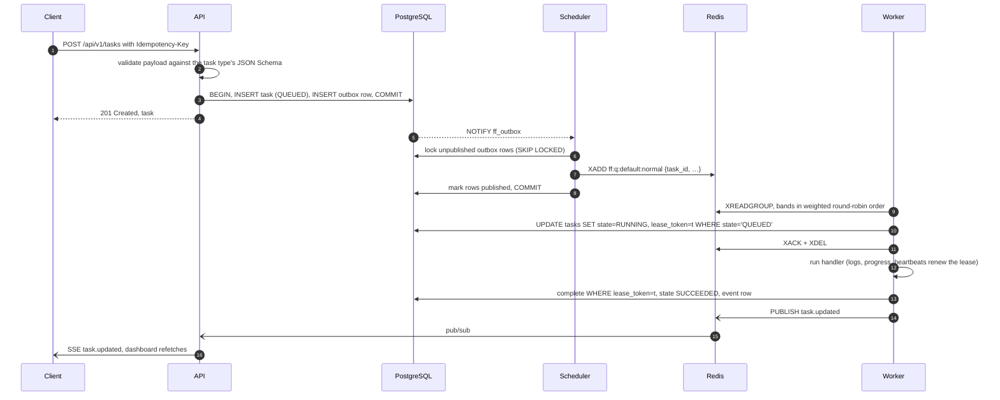

Delayed tasks are created `SCHEDULED` and promoted to `QUEUED`, together with their outbox row, by the scheduler when
they are due. Retries take the same path through `RETRY_SCHEDULED`.

Five rules make this safe:

1. **Claim before acknowledge.** A worker claims the task in PostgreSQL (`UPDATE … WHERE state = 'QUEUED'`, so exactly
   one claimer wins) and only then acknowledges the stream entry. If it dies in between, the entry stays in the
   consumer group's pending list and another worker reclaims it.
2. **Fenced writes.** The claim generates a random `lease_token`. Every later write from that attempt (progress,
   completion, failure) must present it; a mismatch is rejected and recorded as a `FENCED` event.
3. **Leases expire.** Heartbeats renew the lease while the handler runs. If they stop, the reaper expires the lease and
   the task is retried elsewhere.
4. **Duplicates are harmless.** A second delivery of the same entry finds the task no longer `QUEUED`, so the claim
   fails and the entry is discarded (`flowforge_duplicate_deliveries_total`).
5. **The state machine is enforced three times**: in Python, in every SQL `WHERE` clause, and by a PostgreSQL trigger.

### Task state machine

The transition table in [`flowforge_shared/states.py`](packages/shared-schemas/src/flowforge_shared/states.py) is
enforced by `assert_transition` in Python, by guarded `UPDATE … WHERE state IN (legal predecessors)` statements, and
by the `trg_tasks_enforce_transition` trigger, which rejects illegal changes even from manual SQL. An integration test
proves the trigger and the table agree for every pair of states.

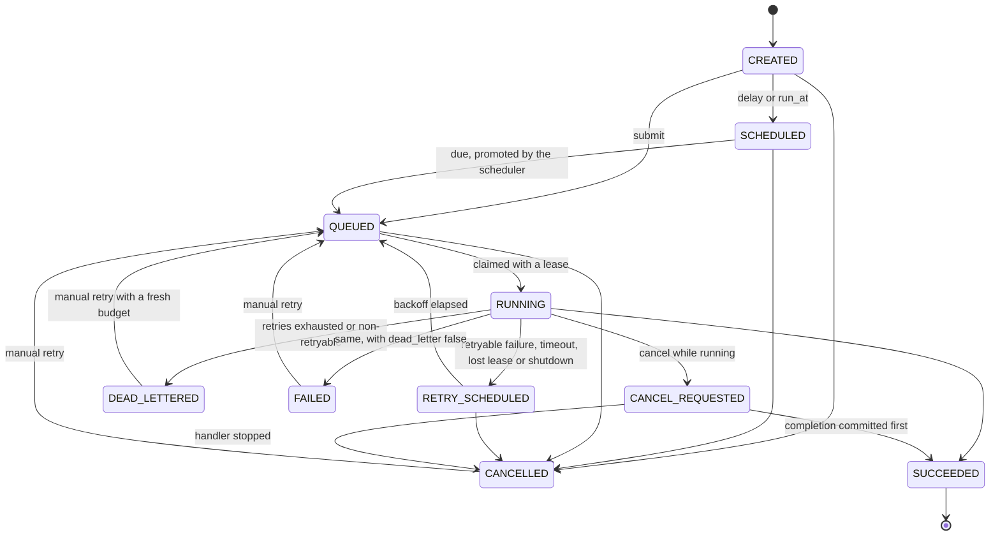

| Group | States | Meaning |
|---|---|---|
| Terminal | `SUCCEEDED`, `FAILED`, `CANCELLED`, `DEAD_LETTERED` | Finished. All but `SUCCEEDED` can be manually re-queued |
| Leased | `RUNNING`, `CANCEL_REQUESTED` | A worker attempt holds a lease |
| Waiting for time | `SCHEDULED`, `RETRY_SCHEDULED` | Promoted to `QUEUED` by the scheduler when due |
| Cancellable at once | `CREATED`, `SCHEDULED`, `QUEUED`, `RETRY_SCHEDULED` | No worker involved, so cancellation is immediate |

Each attempt is recorded in `task_attempts` with one of these outcomes: `SUCCEEDED`, `FAILED`, `TIMED_OUT`, `LOST`
(lease expired), `CANCELLED`, or `INTERRUPTED` (graceful shutdown, does not consume a retry).

### Inside a worker

A worker is one asyncio process ([ADR 0005](docs/decisions/0005-custom-worker-runtime.md)). The supervising coroutine
is never cancelled to stop a handler: timeouts, cancel requests, lease loss and shutdown all cancel the handler's child
task, so the supervisor always records the outcome.

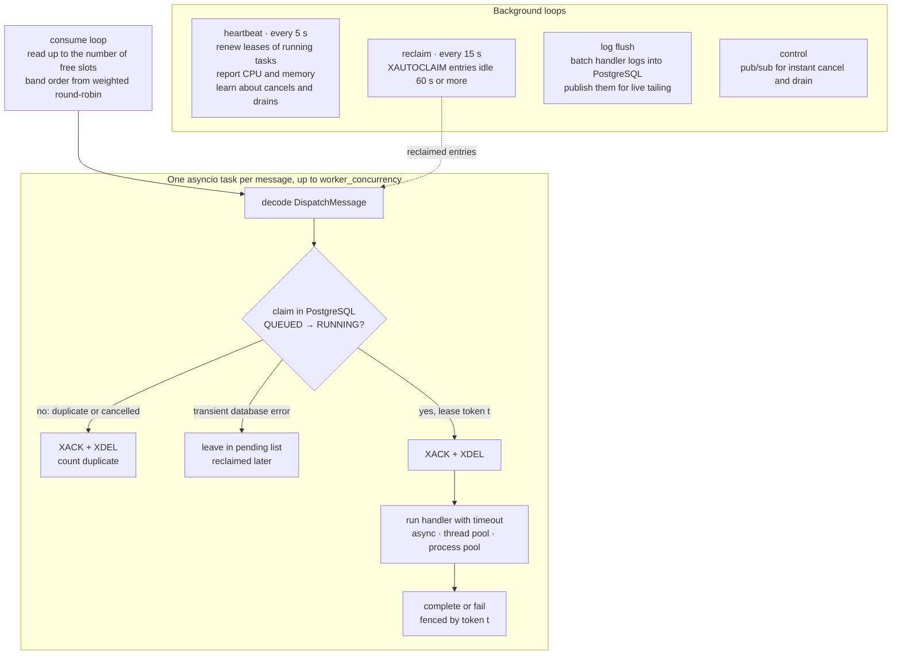

| Executor | Handler signature | Use for |
|---|---|---|
| `async` (default) | `async def handler(ctx: TaskContext, payload)` | I/O-bound work on the event loop |
| `thread` | `def handler(ctx: SyncTaskContext, payload)` | Blocking libraries; `ctx` is a thread-safe view |
| `process` | `def handler(payload)` at module level | CPU-bound work in a process pool (`FLOWFORGE_WORKER_CPU_PROCESSES`, default 2), so a long computation cannot block heartbeats and lose its lease |

**Drain and shutdown.** On `SIGTERM` (or a drain from the Workers page) a worker stops reading, hands back entries it
had read but not claimed, and lets running tasks finish within `FLOWFORGE_WORKER_SHUTDOWN_GRACE_SECONDS`. Tasks still
running at the deadline are released as `INTERRUPTED` and re-queued at once without consuming a retry.

### Inside the control plane

Every scheduler loop is safe to run in several replicas at once. Rows are claimed with `FOR UPDATE SKIP LOCKED` and
every effect is idempotent, so there is no leader election and no failover gap.

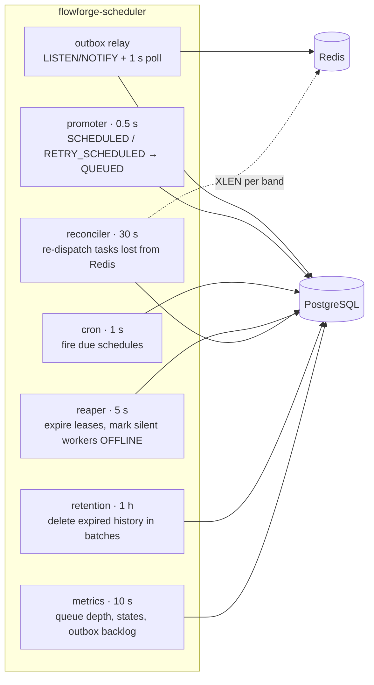

Each loop is supervised: a failing loop backs off and retries, and exports
`flowforge_scheduler_loop_last_success_timestamp` and `flowforge_scheduler_loop_consecutive_failures`, which drive
the `FlowForgeSchedulerLoopStalled` alert.

---

## Priorities, retries and the dead-letter queue

### Priority bands

Redis Streams have no notion of priority, and strict priority ordering would starve low-priority work under load. So
each queue is three streams, and workers choose which band to read first with **smooth weighted round-robin**
(weights 6/3/1, the algorithm nginx uses for upstreams). See [ADR 0006](docs/decisions/0006-priority-bands.md).

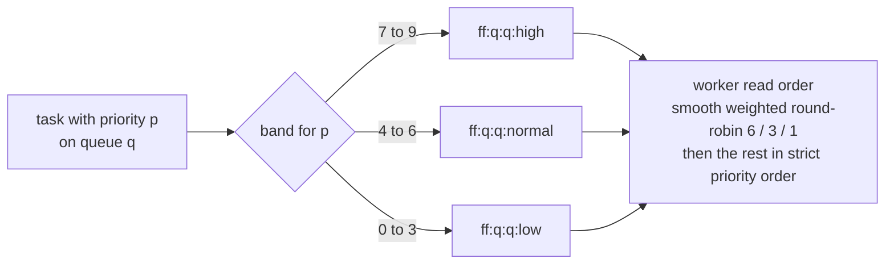

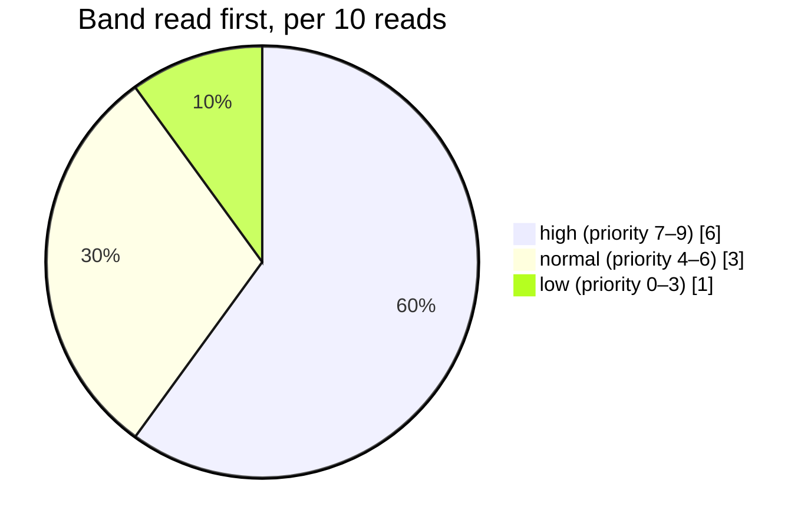

Over ten reads the first band is `H N H H N H L H N H`: high work is strongly preferred, but low-priority work is still
read first about 10% of the time, so it cannot starve. Within a band, ordering is FIFO. If every stream is empty, the
worker blocks on all of them at once, so a new high-priority entry wakes it immediately.

### What happens when an attempt fails

The decision is a pure function, `decide_failure` in
[`flowforge_shared/lifecycle.py`](packages/shared-schemas/src/flowforge_shared/lifecycle.py), covered by 175 unit tests.

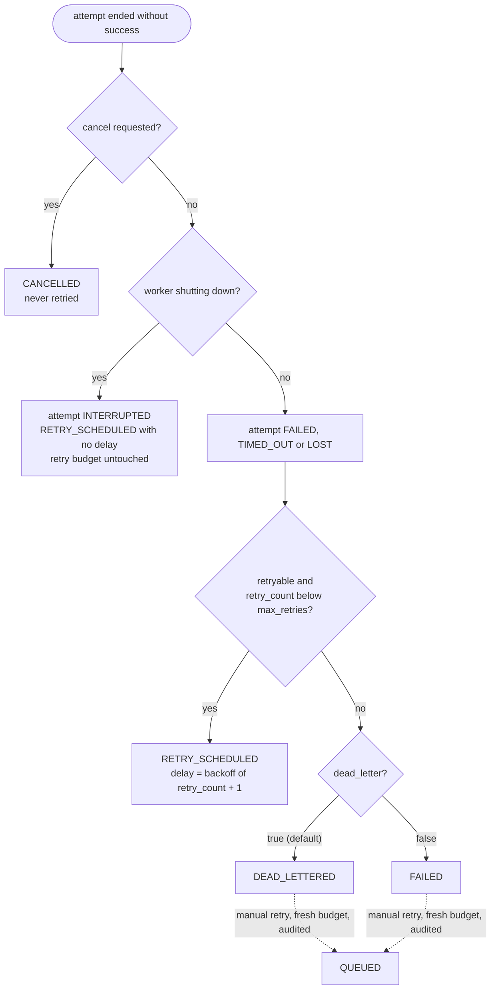

Any unexpected exception is retryable. A handler raises `NonRetryableError` for failures that will never succeed (for
example invalid input), which sends the task straight to the dead-letter queue.

### Exponential backoff with equal jitter

```
delay(n) = min(max, base × 2^(n−1)), then jittered to   delay/2 + uniform(0, delay/2)
```

`base` and `max` come from each task's `retry_backoff_seconds` (default 2 s) and `retry_backoff_max_seconds` (default
300 s). Equal jitter keeps at least half the backoff while spreading retries so failing tasks do not stampede.

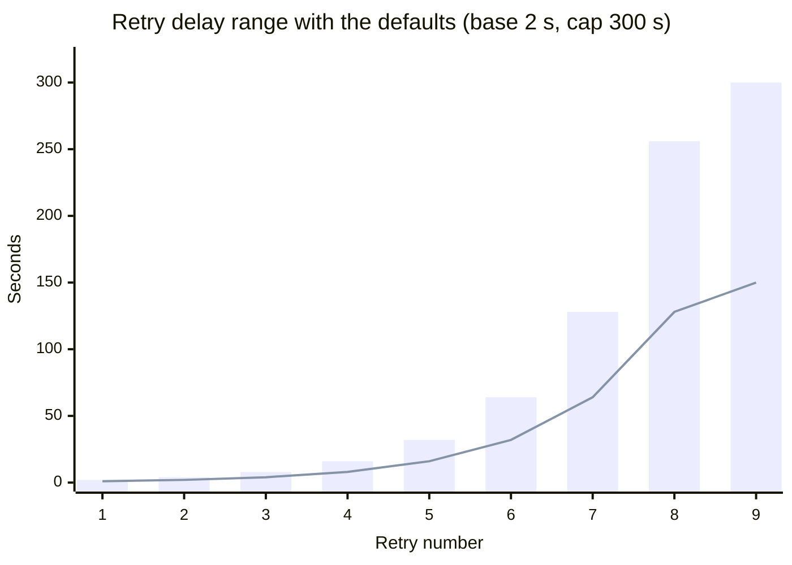

<sub>Bars show the longest possible delay, the line the shortest. Every actual delay falls between them.</sub>

Only failures that are the task's fault consume a retry. The dead-letter queue page lets operators filter, inspect the
last error and traceback, retry with a fresh budget, or archive, one at a time or in bulk with partial-failure
reporting.

### Cancellation

Cancelling a task that is not running (`CREATED`, `SCHEDULED`, `QUEUED`, `RETRY_SCHEDULED`) is immediate. Cancelling a
running task moves it to `CANCEL_REQUESTED`; the worker learns about it instantly through pub/sub (with the heartbeat
as a fallback), marks the context cancelled and cancels the handler. Handlers can cooperate with
`ctx.check_cancelled()`. If the completion commits first, the task ends `SUCCEEDED`, because its side effects already
happened.

---

## Workflows (DAGs)

A workflow is a versioned DAG whose steps are task types. Graphs are validated on save: no cycles (the error names the
cycle's path), at most 200 nodes and 1,000 edges, known task types, and payloads valid for their type. This is the ETL
workflow that `scripts/seed_demo.py` creates from the built-in handlers:

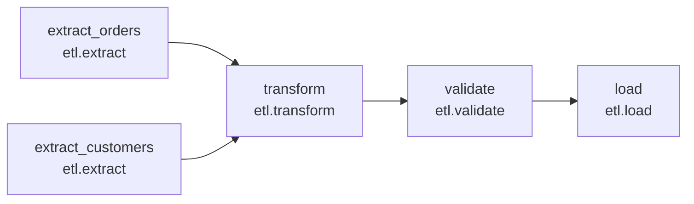

A step's handler reads the run input as `ctx.workflow_input` and its direct parents' results as `ctx.upstream`, keyed
by node key (`ctx.upstream["transform"]`).

### Execution

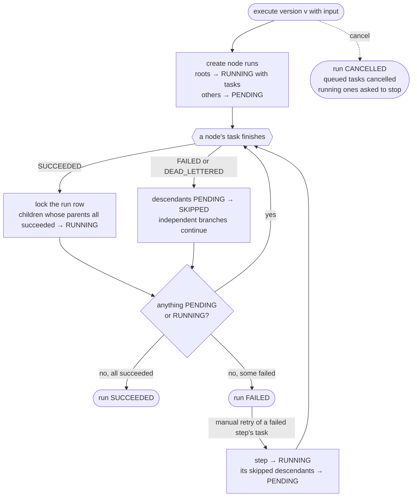

Every progression step locks the run row first (lock order: run before task, everywhere), so two parents finishing at
the same moment start a child exactly once. A partial unique index on `tasks.workflow_node_run_id` is a second,
database-level guarantee.

### Run and step states

<table>
<tr><th>Workflow run</th><th>Workflow step (node run)</th></tr>
<tr><td>

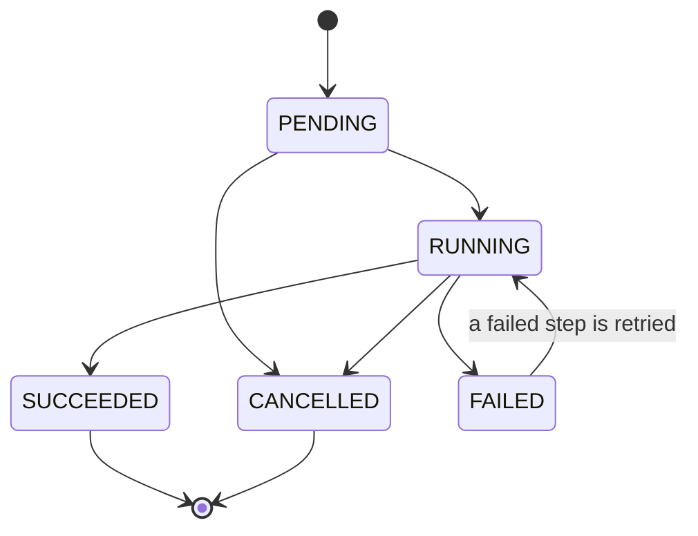

</td><td>

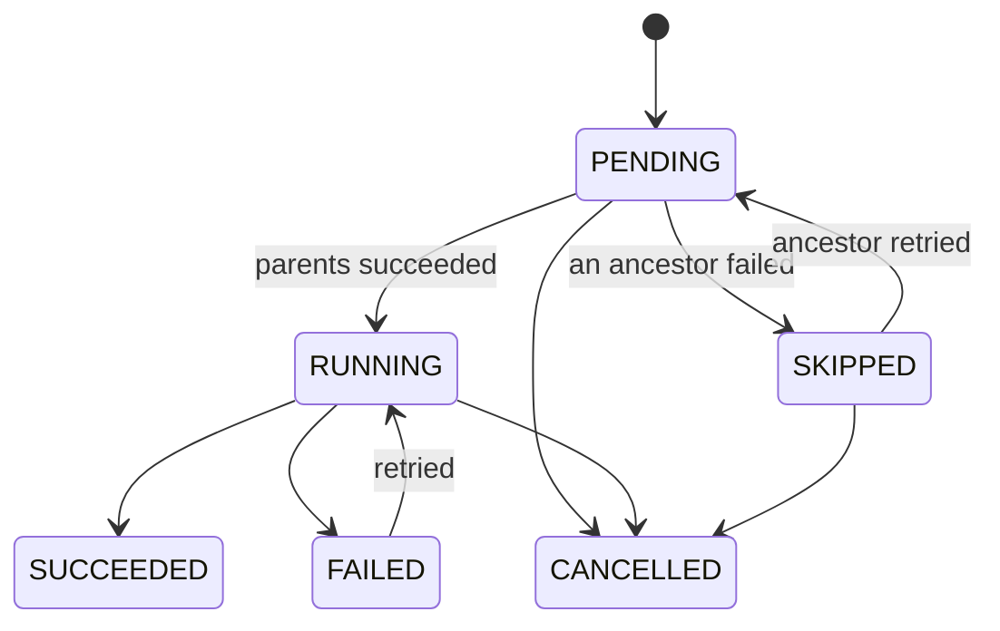

</td></tr>
</table>

### Versioning

Each save creates a new immutable version of the nodes and edges. Passing `expected_version` gives optimistic
concurrency: a stale save from a second editor answers `409` with the latest version number. A run references the
version it started with, so run history always shows the graph that actually ran. Old versions stay browsable
read-only and can be restored as a new version ([ADR 0011](docs/decisions/0011-workflow-versioning.md)).

---

## Cron schedules

Fire times are computed with `cronsim` in the schedule's IANA time zone and stored in UTC
([ADR 0007](docs/decisions/0007-cron-fire-keys.md)). Exactly one task is created per fire time, however many scheduler
replicas run:

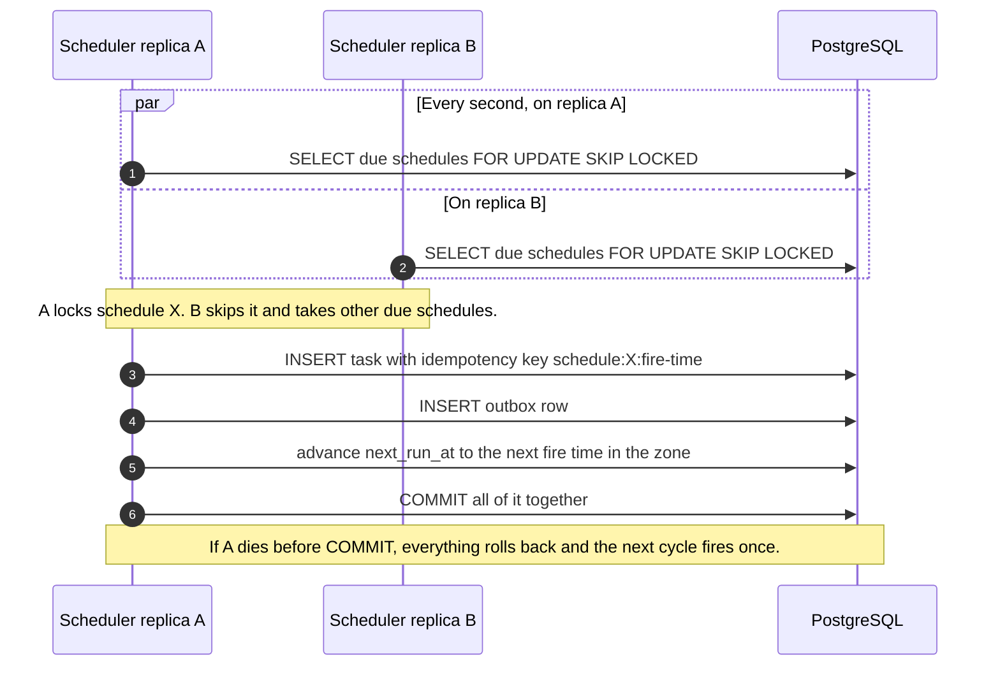

| Policy | Options | Behaviour |
|---|---|---|
| **Misfire** (fire times missed while no scheduler ran) | `RUN_ONCE` | Fire once for the most recent missed time, then continue |
| | `SKIP` | Drop missed fire times |
| **Overlap** (previous task of this schedule still active) | `ALLOW` | Fire anyway |
| | `SKIP` | Skip this fire time |

Daylight saving: a time that does not exist because clocks spring forward runs once, at the first valid instant. A
fixed time inside the repeated autumn hour runs once. The schedule editor previews the next five runs in the chosen
zone and warns when a clock change is coming. Granularity is one minute, as with standard cron.

---

## Realtime updates

Server-Sent Events, fed by Redis pub/sub ([ADR 0009](docs/decisions/0009-sse-realtime.md)). Events only *invalidate*
cached queries; the UI always re-reads authoritative state from the API, so a lost event can never leave it wrong.

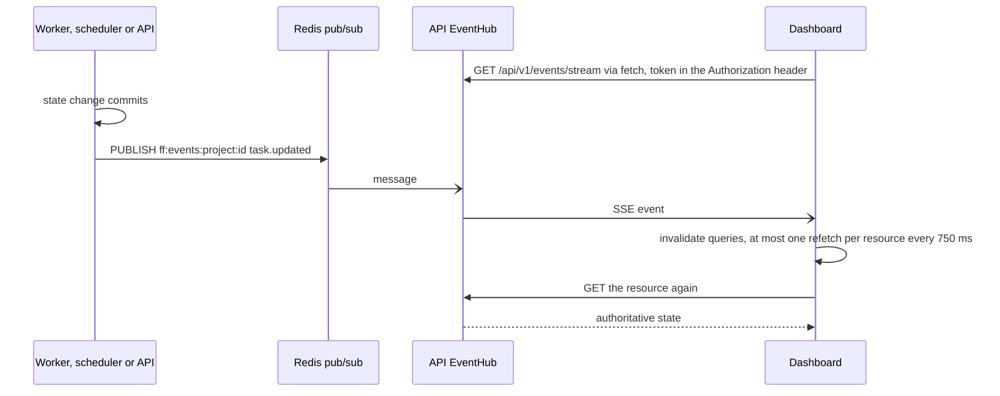

The client reads SSE with `fetch` rather than `EventSource`, so the access token travels in a header, not the URL.
nginx disables buffering on the two stream paths (`/events/stream` and `/tasks/{id}/logs/stream`). When the access
token expires the stream ends; the client refreshes the token and reconnects with backoff, and a reconnect triggers a
full resync.

---

## Reliability model

FlowForge promises **at-least-once execution with exactly-once state transitions**:

* every task ends in exactly one terminal state;
* at most one attempt per task is recorded as successful;
* no submitted task is lost while PostgreSQL keeps its data.

A handler may run more than once when a failure hides the outcome of an earlier attempt (a worker crash after the side
effect, a partition during completion). Handlers receive `ctx.idempotency_key` and `ctx.attempt` so they can make their
side effects idempotent. FlowForge does **not** claim exactly-once execution; no queue can offer it for arbitrary side
effects.

### Where the truth lives

| Store | Role | If it loses data |
|---|---|---|
| **PostgreSQL** | Source of truth: tasks, attempts, leases, events, schedules, workflow runs, outbox | Restore from backup; nothing else can rebuild it |
| **Redis Streams** | Dispatch channel only: "task X is ready" notifications per queue and band | Harmless: the reconciler re-dispatches every `QUEUED` task whose entry is gone |
| **Redis pub/sub** | Realtime fan-out to dashboards | Harmless: clients refetch from the API on reconnect |

### Crash recovery

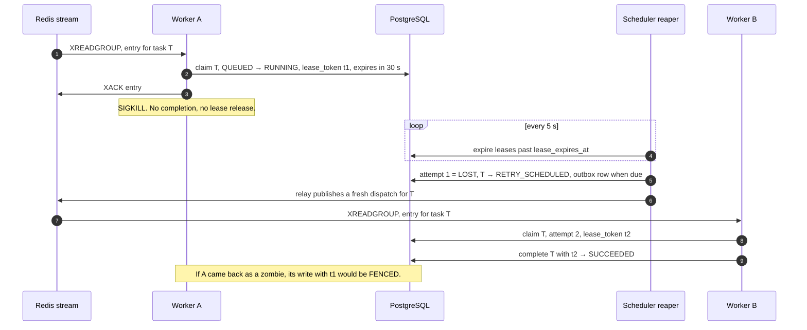

### Failure matrix

Each row is exercised by an automated test. The chaos tier ([`tests/chaos`](tests/chaos)) starts real processes, kills
them with `SIGKILL`, and cuts real TCP connections through a fault-injection proxy.

| If… | then… | Verified by |
|---|---|---|
| a worker is killed mid-task | its lease expires, the attempt is `LOST`, and the task is retried on another worker | `test_worker_killed_mid_task_is_recovered_by_another_worker` (chaos) |
| a worker dies after reading, before claiming | the entry stays pending and is reclaimed with `XAUTOCLAIM` | `test_pending_entry_of_crashed_consumer_is_reclaimed` |
| a claim fails with an unexpected error (a bad release) | the entry stays pending and is retried on every reclaim; the task stays `QUEUED`, uses no attempt, and the `FlowForgeWorkerHandlerCrashes` alert fires | `test_unexpected_claim_error_keeps_entry_pending_until_fixed` |
| a zombie worker writes after its lease was taken over | the write is rejected (fenced) and recorded | `test_zombie_attempt_cannot_overwrite_new_attempt` |
| Redis is unreachable | submissions still succeed (outbox), dispatch resumes on reconnect, nothing is lost | `test_redis_partition_delays_but_loses_nothing` (chaos) |
| Redis restarts without its data | the reconciler re-dispatches from PostgreSQL | `test_redis_restart_without_data_is_repaired_by_reconciler` (chaos) |
| PostgreSQL is unreachable | workers retry claims and completions, stay up, and heal without restarting | `test_postgres_partition_heals_without_restarting_services` (chaos) |
| a stream entry is delivered twice | the second claim finds the task not `QUEUED` and discards it | `test_duplicate_stream_entries_execute_once` |
| two schedulers fire the same schedule, one killed mid-cycle | one task per fire time | `test_scheduler_replicas_fire_exactly_once_even_when_one_is_killed` (chaos) |
| cancel and complete race | exactly one wins, and the state is consistent | `test_concurrent_cancel_and_complete_are_consistent` |
| a worker shuts down gracefully with running tasks | the tasks are handed back without consuming a retry | `test_graceful_shutdown_releases_running_task_without_consuming_retry` |
| two workers race for one task | only one claim succeeds | `test_two_workers_never_both_claim_the_same_task` |

### Recovery timing

| What was lost | Recovered after | Tuned by |
|---|---|---|
| A **running** task (worker vanished) | up to the lease TTL + one reaper interval (30 s + 5 s by default), plus the first retry's backoff | `FLOWFORGE_LEASE_TTL_SECONDS`, `reaper_interval_seconds` |
| An entry **read but not claimed** | `worker_reclaim_min_idle_ms` + up to one reclaim interval (60 s + 15 s by default) | `FLOWFORGE_WORKER_RECLAIM_MIN_IDLE_MS` |
| Redis stream data | once the band's stream is empty and the tasks are older than `reconcile_grace_seconds` (60 s) | `FLOWFORGE_RECONCILE_GRACE_SECONDS` |

Measured under load: tasks that were running on a `SIGKILL`ed worker were retried 33 to 37 seconds later, and entries
it had read but not claimed were picked up 70 seconds later; every task completed exactly once
([performance report](docs/evaluation/performance-report.md#recovery-from-a-killed-worker)). The full model is in
[reliability.md](docs/architecture/reliability.md).

---

## Data model

Twenty-two tables. Every tenant-owned row carries `project_id`, and every query filters by the project resolved from
the caller's credentials. `OUTBOX_EVENTS`, `TASK_TYPES` (the catalog workers publish at start-up) and `WORKERS` have no
tenant.

```mermaid
erDiagram
    ORGANIZATIONS ||--o{ ORGANIZATION_MEMBERS : has
    USERS ||--o{ ORGANIZATION_MEMBERS : joins
    USERS ||--o{ REFRESH_TOKENS : "signs in with"
    ORGANIZATIONS ||--o{ PROJECTS : owns
    PROJECTS ||--o{ API_KEYS : "scoped to"
    PROJECTS ||--o{ TASKS : contains
    PROJECTS ||--o{ SCHEDULES : contains
    PROJECTS ||--o{ WORKFLOWS : contains
    TASKS ||--o{ TASK_ATTEMPTS : "runs as"
    TASKS ||--o{ TASK_EVENTS : timeline
    TASKS ||--o{ TASK_LOGS : writes
    WORKERS ||--o{ TASK_ATTEMPTS : executes
    SCHEDULES ||--o{ TASKS : fires
    WORKFLOWS ||--o{ WORKFLOW_VERSIONS : "is saved as"
    WORKFLOW_VERSIONS ||--o{ WORKFLOW_NODES : has
    WORKFLOW_VERSIONS ||--o{ WORKFLOW_EDGES : has
    WORKFLOWS ||--o{ WORKFLOW_RUNS : "executes as"
    WORKFLOW_VERSIONS ||--o{ WORKFLOW_RUNS : pins
    WORKFLOW_RUNS ||--o{ WORKFLOW_NODE_RUNS : tracks
    WORKFLOW_NODES ||--o{ WORKFLOW_NODE_RUNS : "instantiated by"
    WORKFLOW_NODE_RUNS ||--o| TASKS : "executed by"
    ORGANIZATIONS ||--o{ AUDIT_LOGS : records
    USERS ||--o{ NOTIFICATION_READS : marks

    TASKS {
        uuid id PK "UUIDv7, time-ordered"
        uuid project_id FK
        string state "trigger-enforced transitions"
        string task_type
        string queue
        int priority "0-9"
        jsonb payload "validated against the type's JSON Schema"
        uuid lease_token "fencing token"
        timestamptz lease_expires_at
        int attempt_count
        int retry_count
        string idempotency_key "unique per project"
        int version "optimistic concurrency"
    }
    TASK_ATTEMPTS {
        uuid id PK
        uuid task_id FK
        int attempt_number
        string status "SUCCEEDED FAILED TIMED_OUT LOST CANCELLED INTERRUPTED"
        int queue_wait_ms
        int duration_ms
        text traceback
    }
    OUTBOX_EVENTS {
        bigint id PK
        string stream
        jsonb payload
        timestamptz published_at "null until relayed"
    }
    SCHEDULES {
        uuid id PK
        string cron_expression
        string timezone "IANA"
        timestamptz next_run_at
        string misfire_policy
        string overlap_policy
    }
```

Notable database features:

* **Task IDs are UUIDv7** (RFC 9562): time-ordered, so B-tree inserts are append-mostly and IDs sort by creation time.
* **Partial indexes** keep hot queries small: queued tasks (`state = 'QUEUED'`), time-waiting tasks
  (`SCHEDULED`/`RETRY_SCHEDULED`), leased tasks (`RUNNING`/`CANCEL_REQUESTED`), unpublished outbox rows, and active
  schedules.
* **Partial unique indexes** enforce idempotency keys per project, one task per schedule fire, and one task per workflow
  step.
* **Two triggers**: `trg_tasks_enforce_transition` rejects illegal state changes, and `trg_outbox_events_notify` calls
  `pg_notify('ff_outbox')` to wake the relay.
* **Retention** deletes finished tasks and runs older than `FLOWFORGE_RETENTION_DAYS` (default 30, overridable per
  project), and published outbox rows after 24 hours, in small batches.

---

## Security

### Request pipeline

```mermaid
flowchart LR
    req(["request"]) --> ctx["RequestContext<br/>request id, client IP from<br/>trusted proxy hops"]
    ctx --> sec["SecurityHeaders<br/>nosniff · DENY · no-referrer<br/>CSP · HSTS in production"]
    sec --> size["BodySizeLimit<br/>reject over 1 MiB"]
    size --> cors["CORS<br/>configured origins only"]
    cors --> auth["authenticate<br/>JWT or API key"]
    auth --> rl["rate limit<br/>per identity · per IP on auth"]
    rl --> rbac["project context<br/>role or scope has the permission?"]
    rbac --> handler["handler<br/>queries filtered by project"]
    handler --> uow["unit of work<br/>change + audit + outbox in one transaction"]
```

### Sessions: short tokens and rotating refresh cookies

People get a 15-minute HS256 access token kept only in memory, plus a refresh token in an `httpOnly`,
`SameSite=Strict`, `Secure` cookie scoped to the auth path. Every refresh rotates the token, and reusing an
already-rotated token revokes the whole token family ([ADR 0008](docs/decisions/0008-authentication.md)).

```mermaid
sequenceDiagram
    autonumber
    participant B as Browser
    participant X as Attacker
    participant API
    participant DB as PostgreSQL
    B->>API: POST /auth/login
    API->>DB: verify Argon2id hash, count failures, lock after 5
    API-->>B: access token (15 min, memory only) + refresh cookie R1
    Note over B: Full page reload. The access token is gone.
    B->>API: POST /auth/refresh with cookie R1 and X-Requested-With
    API->>DB: mark R1 rotated, issue R2 in the same family
    API-->>B: new access token + cookie R2
    X->>API: POST /auth/refresh with a stolen copy of R1
    API->>DB: R1 was already rotated, revoke the whole family
    API->>DB: audit session.refresh_reuse_detected
    API-->>X: 401
    Note over B,API: R2 is revoked too, so the real user signs in again.
```

CSRF protection: the cookie is only sent to `/auth/refresh` and `/auth/logout`, which also require
`X-Requested-With: flowforge`; a cross-site request with that header needs a CORS preflight, which fails for unknown
origins. Every other endpoint authenticates with a bearer header, not cookies. Tokens issued before a password change
are rejected.

### Roles and permissions

| Permission | Viewer | Developer | Admin | Owner | API key scope? |
|---|:---:|:---:|:---:|:---:|:---:|
| `tasks:read`, `workflows:read`, `schedules:read`, `analytics:read`, `workers:read` | ✅ | ✅ | ✅ | ✅ | ✅ |
| `tasks:write`, `workflows:write`, `schedules:write` | | ✅ | ✅ | ✅ | ✅ |
| `api_keys:manage`, `members:manage`, `projects:manage`, `audit:read` | | | ✅ | ✅ | ❌ |
| `org:manage` | | | | ✅ | ❌ |

Escalation rules: members can only grant roles at or below their own rank, only owners can grant or revoke the owner
role, and the last owner can never be removed or demoted. Draining shared workers requires a **platform admin**
(`FLOWFORGE_BOOTSTRAP_ADMIN_EMAIL` or `flowforge-admin promote`).

### API keys

Format `ffk_<prefix>_<secret>`. Only a SHA-256 hash and the clear-text prefix are stored; the secret is shown once.
Keys are bound to one project, carry a subset of the non-administrative scopes, can expire, rotate with a configurable
grace period (default 24 hours), and can be revoked immediately. A leaked key can never mint new credentials or manage
members.

### Other controls

* **Input.** Request bodies over 1 MiB and task payloads over 256 KiB are rejected. Payloads are validated against the
  task type's schema by the API and again by the worker. Tasks name a registered handler; nothing evaluates
  user-supplied code. SQL uses bound parameters throughout.
* **Rate limiting.** A Redis sliding-window counter in one Lua script: 1,200 requests per minute per identity, 30 per
  minute per IP on the auth endpoints. Responses are `429` with `Retry-After`. If Redis is down the limiter fails open;
  login lockout is enforced in PostgreSQL and does not depend on it.
* **Audit log.** Registration, logins, lockouts, password changes, refresh-token reuse, member and role changes, API-key
  lifecycle, workflow and schedule changes, task retry, cancel and archive, and worker drains are written in the same
  transaction as the change, with actor, IP, user agent and request id, and without secrets.
* **Logs.** Structured logs redact sensitive keys (`password`, `token`, `secret`, `authorization`, `api_key`, `cookie`,
  `credential`) and mask key- and JWT-shaped strings.
* **Production guards.** With `FLOWFORGE_ENVIRONMENT=production` the services refuse to start with insecure cookies or
  wildcard CORS origins, and every environment requires a JWT secret of at least 32 characters.

Scans on 2026-10-14: `pip-audit` (811 locked runtime requirements) and production `npm audit` found no
vulnerabilities, and `bandit` found no issues after triage. Details: [security review](docs/evaluation/security-review.md).

---

## Observability

```mermaid
flowchart LR
    api["API<br/>/metrics"]
    wk["Workers<br/>:9101/metrics"]
    sc["Scheduler<br/>:9102/metrics"]
    prom["Prometheus<br/>8 alert rules"]
    graf["Grafana<br/>provisioned dashboard"]
    otel["Jaeger or any<br/>OTLP/HTTP collector"]
    logs["Your log pipeline"]

    api & wk & sc --> prom --> graf
    api & wk -- "spans, traceparent carried<br/>inside the stream entry" --> otel
    api & wk & sc -- "JSON lines on stdout<br/>request_id · task_id · trace_id" --> logs
```

<details>
<summary><b>Prometheus metrics</b></summary>

| Area | Metrics |
|---|---|
| Submission and outcomes | `flowforge_tasks_submitted_total`, `flowforge_task_attempts_finished_total`, `flowforge_task_retries_total`, `flowforge_tasks_dead_lettered_total`, `flowforge_tasks_by_state` |
| Latency | `flowforge_task_execution_seconds`, `flowforge_task_queue_wait_seconds`, `flowforge_http_request_duration_seconds` |
| Queues | `flowforge_queue_stream_length`, `flowforge_queue_pending_messages`, `flowforge_tasks_promoted_total` |
| Outbox | `flowforge_outbox_backlog`, `flowforge_outbox_published_total`, `flowforge_outbox_publish_failures_total` |
| Recovery | `flowforge_leases_expired_total`, `flowforge_fenced_writes_total`, `flowforge_duplicate_deliveries_total`, `flowforge_stream_messages_reclaimed_total`, `flowforge_tasks_reconciled_total`, `flowforge_worker_handler_crashes_total` |
| Workers | `flowforge_workers`, `flowforge_worker_active_tasks`, `flowforge_worker_concurrency`, `flowforge_worker_heartbeat_age_seconds` |
| Scheduler | `flowforge_schedule_fires_total`, `flowforge_scheduler_loop_last_success_timestamp`, `flowforge_scheduler_loop_consecutive_failures` |
| Database pools | `flowforge_db_pool_size`, `flowforge_db_pool_checked_out`, `flowforge_db_pool_idle`, `flowforge_db_pool_overflow` |
| API | `flowforge_http_requests_in_flight`, `flowforge_sse_connections`, `flowforge_rate_limited_total`, `flowforge_auth_failures_total`, `flowforge_realtime_publish_failures_total` |

Set `FLOWFORGE_METRICS_TOKEN` to require a bearer token on the API's `/metrics`. nginx never exposes it publicly.

</details>

| Alert ([`alerts.yml`](infrastructure/prometheus/alerts.yml)) | Fires when | Severity |
|---|---|---|
| `FlowForgeNoActiveWorkers` | no `ACTIVE` worker for 2 minutes | critical |
| `FlowForgeSchedulerLoopStalled` | a scheduler loop's last success is over 2 minutes old, sustained for 2 minutes | critical |
| `FlowForgeWorkerHandlerCrashes` | any claim or supervisor crash in 10 minutes | critical |
| `FlowForgeQueueBacklogGrowing` | a queue holds over 1,000 entries and is still growing, for 10 minutes | warning |
| `FlowForgeOutboxBacklog` | over 500 unpublished outbox rows for 5 minutes | warning |
| `FlowForgeDeadLetterSpike` | over 20 tasks dead-lettered in 15 minutes | warning |
| `FlowForgeLeasesExpiring` | over 5 leases expired in 15 minutes | warning |
| `FlowForgeApiErrors` | over 2% of API requests answer 5xx, for 5 minutes | warning |

Health probes: `GET /health/live` (the process is up) and `GET /health/ready` (PostgreSQL and Redis are reachable).
Tracing turns on when `FLOWFORGE_OTEL_EXPORTER_OTLP_ENDPOINT` is set.

---

## The dashboard

The dashboard ([`apps/web`](apps/web)) uses only the public API. Every number on it comes from real data.

| Page | What you can do |
|---|---|
| **Overview** | KPI tiles (running, queued, succeeded, failed, dead-lettered, throughput, duration, workers, queue wait p95), throughput chart with a table view, tasks by state, queue depth, live activity, system health |
| **Tasks** | Search by ID, prefix, idempotency key or type; filter by state, type, queue, schedule or run; sort; cursor pagination; every filter kept in the URL so views are shareable |
| **Task detail** | Status and error panel, timeline of every event, attempts with tracebacks, live log tail with level filter and download, payload, result, metadata; retry and cancel |
| **Workflows** | Cards with the last run, recent runs with step progress; run, duplicate, archive |
| **Workflow builder** | Palette (drag or click), connect steps by dragging handles, cycle rejection with the offending path, step inspector, client and server validation, execution plan by stage, version history with read-only browsing and restore, `Ctrl/⌘+S`, unsaved-changes guard |
| **Workflow run** | Live graph with per-step status and links to each step's task, step table in execution order, cancel |
| **Workers** | Status tiles, slot meter, CPU, memory, uptime, heartbeat age, queues; details sheet; drain and resume for platform admins |
| **Schedules** | Cron editor with presets, a plain-language description and the next five runs in the chosen zone, DST warnings, searchable time-zone picker, misfire and overlap policies, pause, resume, delete; a delayed-tasks tab |
| **Analytics** | Window selector; throughput, latency percentiles over time, slowest types, failure rate by type, errors by type, worker utilization, recent failures |
| **Dead-letter queue** | Filter, inspect (error, last traceback, payload), retry, archive, bulk actions with partial-failure reporting, include archived |
| **API keys** | Scoped creation, secret shown once, rotation with a grace period, revocation |
| **Settings** | Profile, password, theme, notifications; organization, members and roles, projects with retention, the role matrix; the audit log |

Accessibility: a skip link, landmarks, one `h1` per page, labelled fields with announced errors, status never shown by
colour alone, `role="log"` for the live log, confirmation dialogs for destructive actions, full keyboard support,
`Ctrl+K` command palette, and `prefers-reduced-motion`. Charts use a palette validated for colour-vision deficiency in
both themes. See the [UI review](docs/evaluation/ui-review.md).

---

## Getting started

### Option 1: Docker Compose

```bash
cp .env.example .env    # replace each __GENERATE__ with a random value, e.g. openssl rand -hex 32
docker compose up --build -d
```

Open <http://localhost:8080> and register. The account whose email matches `FLOWFORGE_BOOTSTRAP_ADMIN_EMAIL` becomes a
platform admin.

```bash
docker compose --profile observability up -d   # Prometheus :9090, Grafana :3001, Jaeger :16686
docker compose up -d --scale worker=4          # more workers; they coordinate through PostgreSQL + Redis
```

> **Verification status.** The Compose stack, both Dockerfiles, nginx, Prometheus and Grafana are checked by CI
> (config validation, image builds, and the Playwright suite against Compose). The machine FlowForge was built on has
> no Docker, so the stack was not started there; see [known issues](docs/evaluation/known-issues.md). The native
> stack below runs the same code and is what every local test used.

### Option 2: Local development (no Docker needed)

Prerequisites: [uv](https://docs.astral.sh/uv/), Node.js 22 or newer, and on Windows, WSL (for Redis).

```bash
uv sync                                  # Python workspace and dev tools
python scripts/devstack.py init-env      # .env with generated secrets
python scripts/devstack.py up            # portable PostgreSQL + Redis (native, or WSL on Windows), databases created
uv run flowforge-admin migrate

uv run flowforge-api                     # http://127.0.0.1:8000  (OpenAPI docs at /docs, ReDoc at /redoc)
uv run flowforge-worker                  # metrics on :9101
uv run flowforge-scheduler               # metrics on :9102
cd apps/web && npm ci && npm run dev     # http://localhost:3000
```

### Demo data

```bash
uv run python scripts/seed_demo.py       # needs the API, a worker and the scheduler running
```

The seeder registers a clearly labelled demo account (`demo@example.com`), submits tasks of every built-in type
(including some that deliberately fail into the dead-letter queue, and a delayed one), creates and runs the ETL
workflow, and adds two schedules (a nightly report at 02:00 `Asia/Kolkata` and a no-op every five minutes in UTC). Nothing is
fabricated: the workers actually run all of it.

`make help` lists every development command; see [Make targets](#make-targets).

> **Windows notes.** Use `127.0.0.1` rather than `localhost` in connection strings (the WSL port relay listens only on
> IPv4, and the IPv6 attempt costs about 2 s per connection). npm scripts break when the path contains `&`; set
> `npm_config_script_shell` to Git Bash.

---

## Configuration

Settings come from `FLOWFORGE_*` environment variables or `.env`, and map one-to-one to the fields of
[`flowforge_core.config.Settings`](packages/core/src/flowforge_core/config.py).
[`.env.example`](.env.example) documents the common ones. Defaults are production-safe; secrets have no defaults.

| Variable | Default | Notes |
|---|---|---|
| `FLOWFORGE_ENVIRONMENT` | `development` | `production` refuses insecure cookies and wildcard CORS |
| `FLOWFORGE_DATABASE_URL` | – | `postgresql+asyncpg://…` |
| `FLOWFORGE_REDIS_URL` | – | `redis://host:6379/0` (`rediss://` for TLS) |
| `FLOWFORGE_JWT_SECRET` | – | At least 32 characters. Changing it signs everyone out |
| `FLOWFORGE_COOKIE_SECURE` | `true` | Keep `true` behind HTTPS |
| `FLOWFORGE_CORS_ORIGINS` | `http://localhost:3000` | Comma-separated; only needed when the dashboard is on another origin |
| `FLOWFORGE_TRUSTED_PROXY_COUNT` | `0` | Reverse proxies in front of the API (Compose sets `1` for nginx) |
| `FLOWFORGE_ALLOW_REGISTRATION` | `true` | Set `false` once your users exist |
| `FLOWFORGE_BOOTSTRAP_ADMIN_EMAIL` | – | This account becomes platform admin on registration |
| `FLOWFORGE_WORKER_QUEUES` | `default` | Comma-separated queues a worker consumes |
| `FLOWFORGE_WORKER_CONCURRENCY` | `8` | Execution slots per worker process |
| `FLOWFORGE_WORKER_CPU_PROCESSES` | `2` | Process-pool size for `executor="process"` handlers |
| `FLOWFORGE_LEASE_TTL_SECONDS` | `30` | Crash-detection time versus heartbeat tolerance |
| `FLOWFORGE_DATABASE_POOL_SIZE` | `10` | Per process. A worker needs at least concurrency + 2 |
| `FLOWFORGE_RETENTION_DAYS` | `30` | Finished history older than this is deleted (per-project override) |
| `FLOWFORGE_OTEL_EXPORTER_OTLP_ENDPOINT` | empty | OTLP/HTTP endpoint for traces |
| `FLOWFORGE_METRICS_TOKEN` | empty | If set, `/metrics` requires `Authorization: Bearer <token>` |

<details>
<summary><b>All settings</b></summary>

| Group | Variable (prefix `FLOWFORGE_`) | Default |
|---|---|---|
| General | `ENVIRONMENT` · `SERVICE_NAME` · `LOG_LEVEL` · `LOG_JSON` | `development` · `flowforge` · `INFO` · `true` |
| Database | `DATABASE_URL` · `DATABASE_POOL_SIZE` · `DATABASE_MAX_OVERFLOW` · `DATABASE_POOL_TIMEOUT_SECONDS` · `DATABASE_STATEMENT_TIMEOUT_MS` · `DATABASE_ECHO` | – · `10` · `10` · `10` · `30000` · `false` |
| Redis | `REDIS_URL` · `REDIS_PREFIX` | – · `ff` |
| Tokens and cookies | `JWT_SECRET` · `JWT_ISSUER` · `JWT_AUDIENCE` · `ACCESS_TOKEN_TTL_SECONDS` · `REFRESH_TOKEN_TTL_SECONDS` · `COOKIE_SECURE` · `COOKIE_SAMESITE` · `COOKIE_DOMAIN` | – · `flowforge` · `flowforge-api` · `900` · `1209600` (14 days) · `true` · `strict` · – |
| Accounts | `ALLOW_REGISTRATION` · `BOOTSTRAP_ADMIN_EMAIL` · `LOGIN_MAX_FAILURES` · `LOGIN_LOCKOUT_SECONDS` | `true` · – · `5` · `300` |
| Abuse limits | `RATE_LIMIT_ENABLED` · `RATE_LIMIT_PER_MINUTE` · `AUTH_RATE_LIMIT_PER_MINUTE` · `MAX_REQUEST_BYTES` · `MAX_PAYLOAD_BYTES` | `true` · `1200` · `30` · 1 MiB · 256 KiB |
| API keys and edge | `API_KEY_ROTATION_GRACE_SECONDS` · `METRICS_TOKEN` · `TRUSTED_PROXY_COUNT` · `CORS_ORIGINS` | `86400` · – · `0` · `http://localhost:3000` |
| Worker | `WORKER_NAME` · `WORKER_QUEUES` · `WORKER_CONCURRENCY` · `WORKER_CPU_PROCESSES` · `WORKER_HEARTBEAT_INTERVAL_SECONDS` · `WORKER_SHUTDOWN_GRACE_SECONDS` · `WORKER_RECLAIM_INTERVAL_SECONDS` · `WORKER_RECLAIM_MIN_IDLE_MS` · `WORKER_POLL_BLOCK_MS` · `WORKER_EXIT_WHEN_DRAINED` · `WORKER_METRICS_PORT` · `LEASE_TTL_SECONDS` | hostname · `default` · `8` · `2` · `5` · `30` · `15` · `60000` · `1000` · `false` · `9101` · `30` |
| Control plane | `SCHEDULER_POLL_INTERVAL_SECONDS` · `SCHEDULER_BATCH_SIZE` · `REAPER_INTERVAL_SECONDS` · `WORKER_OFFLINE_AFTER_SECONDS` · `RECONCILE_INTERVAL_SECONDS` · `RECONCILE_GRACE_SECONDS` · `RETENTION_INTERVAL_SECONDS` · `RETENTION_DAYS` · `OUTBOX_RETENTION_HOURS` · `SCHEDULER_METRICS_PORT` | `0.5` · `500` · `5` · `30` · `30` · `60` · `3600` · `30` · `24` · `9102` |
| Tracing | `OTEL_EXPORTER_OTLP_ENDPOINT` · `OTEL_SAMPLE_RATIO` | – · `1.0` |
| Worker handlers | `WORKER_HANDLER_MODULES` | Comma-separated `module:attribute` registries to load |

Compose also reads `POSTGRES_USER`, `POSTGRES_PASSWORD`, `POSTGRES_DB`, `GRAFANA_ADMIN_PASSWORD` and
`FLOWFORGE_HTTP_PORT` (default `8080`). The dashboard build reads `NEXT_PUBLIC_API_BASE_URL`.

</details>

---

## Using the API

The API lives under `/api/v1`. Interactive docs are served at `/docs` (Swagger UI) and `/redoc`, and the OpenAPI
document is committed at [`packages/shared-schemas/openapi.json`](packages/shared-schemas/openapi.json); CI fails if it
drifts from the code.

**Authentication.** People send `Authorization: Bearer <access token>` plus `X-Project-ID: <project uuid>`. Services
send a project-scoped API key as `Authorization: Bearer ffk_…` or `X-API-Key: ffk_…` (the key implies the project).

**Errors** always use one envelope:

```json
{ "error": { "code": "validation_failed", "message": "…", "details": { }, "request_id": "…" } }
```

### Examples

Create an API key in the dashboard (API Keys → Create key), then:

```bash
# Submit. Idempotency-Key makes retries of this request safe: a replay returns the original task
# (with an Idempotent-Replayed header), and reusing the key for a different request answers 409.
curl -s http://localhost:8000/api/v1/tasks \
  -H "Authorization: Bearer $FLOWFORGE_API_KEY" \
  -H "Idempotency-Key: invoice-2026-10-001" \
  -H "Content-Type: application/json" \
  -d '{"task_type": "send_email", "payload": {"to": "ada@example.com", "subject": "Hello", "body": "Hi!"}, "priority": 7}'

# Inspect one task, or list failures
curl -s http://localhost:8000/api/v1/tasks/$TASK_ID -H "Authorization: Bearer $FLOWFORGE_API_KEY"
curl -s "http://localhost:8000/api/v1/tasks?state=FAILED&state=DEAD_LETTERED&limit=50" \
  -H "Authorization: Bearer $FLOWFORGE_API_KEY"

# Delay, retry policy, timeout and backoff
curl -s http://localhost:8000/api/v1/tasks -H "Authorization: Bearer $FLOWFORGE_API_KEY" \
  -H "Content-Type: application/json" \
  -d '{"task_type": "generate_report", "payload": {"report_id": 7}, "delay_seconds": 600,
       "max_retries": 5, "timeout_seconds": 120, "retry_backoff_seconds": 5, "retry_backoff_max_seconds": 600}'

# Up to 1,000 tasks atomically
curl -s http://localhost:8000/api/v1/tasks/batch -H "Authorization: Bearer $FLOWFORGE_API_KEY" \
  -H "Content-Type: application/json" \
  -d '{"tasks": [{"task_type": "demo.noop"}, {"task_type": "demo.sleep", "payload": {"seconds": 2}}]}'
```

### Submission fields

| Field | Type | Default | Notes |
|---|---|---|---|
| `task_type` | string | required | A type a worker has registered (`GET /task-types`) |
| `payload` | object | `{}` | Validated against the type's JSON Schema; at most 256 KiB |
| `queue` | string | the type's queue | `^[a-z0-9][a-z0-9_-]{0,62}$` |
| `priority` | int 0–9 | the type's priority (usually 5) | 7–9 high, 4–6 normal, 0–3 low |
| `max_retries` | int 0–100 | the type's value (usually 3) | Automatic retries after the first attempt |
| `timeout_seconds` | int 1–86,400 | the type's value | Handler is cancelled after this, and the attempt is `TIMED_OUT` |
| `retry_backoff_seconds` | float | `2.0` | Backoff base |
| `retry_backoff_max_seconds` | float | `300.0` | Backoff cap |
| `dead_letter` | bool | `true` | `false` ends permanent failures in `FAILED` instead |
| `delay_seconds` / `run_at` | float / datetime | – | One or the other; `run_at` needs a time-zone offset |
| `idempotency_key` | string | – | Or the `Idempotency-Key` header; unique per project |
| `metadata` | object | `{}` | Free-form, passed to the handler as `ctx.metadata` |

<details>
<summary><b>Endpoint reference</b> (72 operations)</summary>

**Tasks**

| Method | Path | Purpose |
|---|---|---|
| `POST` | `/api/v1/tasks` | Submit a task |
| `POST` | `/api/v1/tasks/batch` | Submit up to 1,000 tasks atomically |
| `GET` | `/api/v1/tasks` | List and filter tasks (cursor pagination) |
| `GET` | `/api/v1/tasks/{task_id}` | Get a task |
| `POST` | `/api/v1/tasks/{task_id}/cancel` | Cancel a task |
| `POST` | `/api/v1/tasks/{task_id}/retry` | Manually retry a failed, cancelled or dead-lettered task |
| `GET` | `/api/v1/tasks/{task_id}/attempts` | List attempts |
| `GET` | `/api/v1/tasks/{task_id}/events` | List timeline events |
| `GET` | `/api/v1/tasks/{task_id}/logs` | List log lines |
| `GET` | `/api/v1/tasks/{task_id}/logs/stream` | Live log tail with backlog (SSE) |
| `GET` | `/api/v1/task-types` | Task types registered by workers |

**Dead-letter queue**

| Method | Path | Purpose |
|---|---|---|
| `GET` | `/api/v1/dead-letter` | Dead-lettered tasks |
| `POST` | `/api/v1/dead-letter/{task_id}/retry` | Retry one |
| `POST` | `/api/v1/dead-letter/{task_id}/archive` | Archive one |
| `POST` | `/api/v1/dead-letter/retry` | Retry several |
| `POST` | `/api/v1/dead-letter/archive` | Archive several |

**Workflows**

| Method | Path | Purpose |
|---|---|---|
| `GET` | `/api/v1/workflows` | List workflows |
| `POST` | `/api/v1/workflows` | Create a workflow |
| `POST` | `/api/v1/workflows/validate` | Validate a graph without saving it |
| `GET` | `/api/v1/workflows/{workflow_id}` | Get a workflow |
| `PUT` | `/api/v1/workflows/{workflow_id}` | Save a new version (optimistic concurrency) |
| `DELETE` | `/api/v1/workflows/{workflow_id}` | Archive a workflow |
| `POST` | `/api/v1/workflows/{workflow_id}/execute` | Start a run |
| `GET` | `/api/v1/workflows/{workflow_id}/runs` | Runs of one workflow |
| `GET` | `/api/v1/workflow-runs` | List runs |
| `GET` | `/api/v1/workflow-runs/{run_id}` | Get a run with its steps |
| `POST` | `/api/v1/workflow-runs/{run_id}/cancel` | Cancel a run |

**Schedules**

| Method | Path | Purpose |
|---|---|---|
| `GET` | `/api/v1/schedules` | List schedules |
| `POST` | `/api/v1/schedules` | Create a schedule |
| `POST` | `/api/v1/schedules/preview` | Validate a cron expression and preview fire times |
| `GET` | `/api/v1/schedules/{schedule_id}` | Get a schedule |
| `PATCH` | `/api/v1/schedules/{schedule_id}` | Update, pause or resume (optimistic concurrency) |
| `DELETE` | `/api/v1/schedules/{schedule_id}` | Delete a schedule |

**Workers**

| Method | Path | Purpose |
|---|---|---|
| `GET` | `/api/v1/workers` | Worker fleet (live plus seen in the last 24 h) |
| `GET` | `/api/v1/workers/{worker_id}` | Get a worker |
| `POST` | `/api/v1/workers/{worker_id}/drain` | Stop taking new tasks (platform admins) |
| `POST` | `/api/v1/workers/{worker_id}/resume` | Take tasks again (platform admins) |

**Analytics**

| Method | Path | Purpose |
|---|---|---|
| `GET` | `/api/v1/analytics/overview` | Headline numbers for the overview page |
| `GET` | `/api/v1/analytics/throughput` | Submitted, succeeded, failed and retried per time bucket |
| `GET` | `/api/v1/analytics/latency` | p50/p95/p99 execution time, queue wait and end-to-end latency |
| `GET` | `/api/v1/analytics/failures` | Failure rates by task type and error type, recent failures |
| `GET` | `/api/v1/analytics/workers` | Per-worker slot utilization |

**Authentication and account**

| Method | Path | Purpose |
|---|---|---|
| `POST` | `/api/v1/auth/register` | Create an account, an organization and a default project |
| `POST` | `/api/v1/auth/login` | Sign in |
| `POST` | `/api/v1/auth/refresh` | Rotate the refresh cookie, issue a new access token |
| `POST` | `/api/v1/auth/logout` | Revoke the current refresh-token family |
| `GET` | `/api/v1/auth/me` | Current user |
| `PATCH` | `/api/v1/auth/me` | Update profile and preferences |
| `POST` | `/api/v1/auth/change-password` | Change password |

**API keys**

| Method | Path | Purpose |
|---|---|---|
| `GET` | `/api/v1/api-keys` | List keys |
| `POST` | `/api/v1/api-keys` | Create a scoped key (secret returned once) |
| `POST` | `/api/v1/api-keys/{key_id}/rotate` | Issue a replacement; the old key works for the grace period |
| `DELETE` | `/api/v1/api-keys/{key_id}` | Revoke a key |

**Organizations, projects and notifications**

| Method | Path | Purpose |
|---|---|---|
| `GET` | `/api/v1/organizations/roles` | Role → permission matrix and API-key scopes |
| `GET` | `/api/v1/organizations/{org_id}` | Get an organization |
| `PATCH` | `/api/v1/organizations/{org_id}` | Rename an organization |
| `GET` | `/api/v1/organizations/{org_id}/members` | List members |
| `POST` | `/api/v1/organizations/{org_id}/members` | Add a member |
| `PATCH` | `/api/v1/organizations/{org_id}/members/{member_id}` | Change a member's role |
| `DELETE` | `/api/v1/organizations/{org_id}/members/{member_id}` | Remove a member |
| `POST` | `/api/v1/organizations/{org_id}/projects` | Create a project |
| `GET` | `/api/v1/organizations/{org_id}/audit-logs` | Audit log |
| `GET` | `/api/v1/projects` | Projects visible to the current user |
| `PATCH` | `/api/v1/projects/{project_id}` | Update a project (name, retention) |
| `GET` | `/api/v1/notifications` | Recent notable events for the project |
| `POST` | `/api/v1/notifications/read` | Mark all as read |

**Realtime, health and system**

| Method | Path | Purpose |
|---|---|---|
| `GET` | `/api/v1/events/stream` | Live task, workflow, schedule and worker events (SSE) |
| `GET` | `/api/v1/system/status` | Platform status for the dashboard top bar |
| `GET` | `/health/live`, `/api/v1/health/live` | Liveness probe |
| `GET` | `/health/ready`, `/api/v1/health/ready` | Readiness probe (PostgreSQL and Redis) |
| `GET` | `/metrics` | Prometheus metrics (not in the OpenAPI document) |

</details>

---

## Python SDK

[`flowforge_sdk`](packages/python-sdk) depends only on `httpx`. Both clients retry transient failures with backoff and
honour `Retry-After`, and map errors to typed exceptions (`AuthenticationError`, `PermissionDeniedError`,
`NotFoundError`, `ConflictError`, `PayloadTooLargeError`, `RateLimitError`, `ServerError`).

```python
from flowforge_sdk import FlowForgeClient

with FlowForgeClient("http://localhost:8000", api_key="ffk_…") as ff:
    task = ff.submit("generate_report", {"report_id": 42}, priority=8, idempotency_key="report-42")
    done = ff.wait(task.id, timeout=120)
    print(done.state, done.result)

    run = ff.execute_workflow(workflow_id, input={"date": "2026-10-14"})
```

```python
from flowforge_sdk import AsyncFlowForgeClient


async def main() -> None:
    async with AsyncFlowForgeClient("http://localhost:8000", api_key="ffk_…") as ff:
        await ff.submit("demo.sleep", {"seconds": 2}, delay_seconds=30)
        async for failed in ff.iter_tasks(state="DEAD_LETTERED"):
            await ff.retry(failed.id)
```

| Method | Does |
|---|---|
| `submit(task_type, payload, *, queue, priority, max_retries, timeout_seconds, delay_seconds, run_at, idempotency_key, metadata, dead_letter)` | Submit one task. Without an idempotency key the SDK generates one, so its own retries are safe |
| `submit_batch(tasks)` | Up to 1,000 tasks atomically |
| `get`, `list`, `iter_tasks` | Read tasks; `iter_tasks` follows cursors |
| `cancel`, `retry` | Cancel or manually retry |
| `attempts`, `logs` | Attempt history and log lines |
| `wait(task_id, timeout, poll_interval)` | Poll until terminal (raises `TaskWaitTimeout`; the task keeps running) |
| `task_types()` | The registered catalog |
| `execute_workflow(workflow_id, input, version)`, `get_workflow_run(run_id)` | Run and inspect workflows |

---

## Writing task handlers

Handlers are typed functions registered with a Pydantic payload model. At start-up the worker publishes each type and
its payload's JSON Schema to the catalog, and the API validates every submission against it.

```python
from pydantic import BaseModel, Field
from flowforge_worker.context import TaskContext
from flowforge_worker.errors import NonRetryableError
from flowforge_worker.registry import TaskRegistry

registry = TaskRegistry()


class ResizeImage(BaseModel):
    url: str
    width: int = Field(gt=0, le=4096)


@registry.task(
    "images.resize",
    payload=ResizeImage,
    queue="media",
    max_retries=5,
    timeout=120,
    example={"url": "https://example.com/a.png", "width": 800},
)
async def resize(ctx: TaskContext, payload: ResizeImage) -> dict:
    if not payload.url.startswith("https://"):
        raise NonRetryableError("only https URLs are accepted")  # straight to the dead-letter queue
    ctx.log.info("resizing", width=payload.width)
    await ctx.progress(50, "downloaded")
    ctx.check_cancelled()  # cooperate with cancellation between steps
    ...  # do the work idempotently: it may run more than once
    return {"width": payload.width}
```

Run it with:

```bash
flowforge-worker --handlers mypackage.tasks:registry --queues media
# or: FLOWFORGE_WORKER_HANDLER_MODULES=mypackage.tasks:registry flowforge-worker
```

Use `executor="thread"` (with a `SyncTaskContext`) for blocking libraries and `executor="process"` (a module-level
`def handler(payload)`) for CPU-bound work. Registration rejects mismatches, such as an `async def` with
`executor="thread"` or an example payload that does not validate.

### The task context

| Member | Description |
|---|---|
| `ctx.task_id`, `ctx.project_id`, `ctx.task_type`, `ctx.queue`, `ctx.priority` | Identity of the task |
| `ctx.attempt`, `ctx.retry_count`, `ctx.max_retries`, `ctx.is_last_attempt` | Retry state |
| `ctx.idempotency_key`, `ctx.metadata` | For idempotent side effects and caller context |
| `ctx.log.debug/info/warning/error(message, **fields)` | Per-attempt logs, streamed to the dashboard |
| `await ctx.progress(percent, message)` | Progress, throttled to two writes per second |
| `ctx.is_cancelled()`, `ctx.check_cancelled()` | Cooperative cancellation |
| `ctx.workflow_input`, `ctx.upstream` | Inside a workflow: the run input and parents' results by node key |

### Built-in handlers

| Type | Queue | Executor | What it does |
|---|---|---|---|
| `demo.noop` | default | async | Nothing; measures pure platform overhead (used by the benchmarks) |
| `demo.sleep` | default | async | Waits without blocking, reporting progress (I/O-bound simulation) |
| `demo.cpu_hash` | default | process | Iterated SHA-256 in the process pool (CPU-bound simulation) |
| `demo.flaky` | default | async | Fails at random with a retryable error, to show backoff |
| `demo.fail` | default | async | Always fails, to show the dead-letter queue |
| `generate_report` | reports | thread | Builds a deterministic synthetic sales report |
| `send_email` | default | async | Simulated email delivery that uses the idempotency key as a dedupe key |
| `etl.extract`, `etl.transform`, `etl.validate`, `etl.load` | default | async | Workflow steps for the demo ETL pipeline |

Start a worker with `--no-builtin` to load only your own handlers.

---

## Command-line tools

| Command | Purpose |
|---|---|
| `flowforge-api` | Run the API on `FLOWFORGE_API_HOST`:`FLOWFORGE_API_PORT` (default `127.0.0.1:8000`; containers bind `0.0.0.0`) |
| `flowforge-worker [--queues q1,q2] [--concurrency N] [--name NAME] [--metrics-port P] [--handlers mod:attr]… [--no-builtin]` | Run a worker |
| `flowforge-scheduler` | Run the control plane |
| `flowforge-admin migrate [--revision REV]` | Apply migrations (default: head) |
| `flowforge-admin downgrade REV` · `current` · `makemigration MSG [--empty]` | Roll back, show the revision, autogenerate a migration |
| `flowforge-admin promote EMAIL` · `demote EMAIL` | Grant or revoke platform-admin rights |
| `flowforge-admin create-admin EMAIL --name NAME [--organization ORG]` | Create a platform admin (password from `FLOWFORGE_ADMIN_PASSWORD` or a prompt) |
| `flowforge-admin set-password EMAIL` | Reset a password (same password source) |
| `python scripts/devstack.py init-env \| up \| down \| status \| psql \| start-redis \| stop-redis \| …` | The native development stack |
| `python scripts/seed_demo.py [--api URL] [--email E] [--tasks N]` | Seed real demo work |
| `python scripts/export_openapi.py [--check]` | Regenerate (or check) the committed OpenAPI document |

### Make targets

| Target | Does |
|---|---|
| `make setup` | Install Python and Node dependencies, create `.env` with generated secrets |
| `make dev-up` / `dev-down` / `dev-status` | Start, stop or inspect the native PostgreSQL and Redis (and migrate) |
| `make api` / `worker` / `scheduler` / `web` | Run one process |
| `make seed` | Submit real demo tasks, a workflow run and schedules |
| `make lint` / `format` / `typecheck` | ruff and ESLint; auto-format; mypy strict and `tsc` |
| `make test` | Unit + integration (with the coverage gate) + dashboard tests |
| `make test-unit` / `test-integration` / `test-web` | One tier |
| `make chaos` | Fault injection with real process kills and partitions |
| `make e2e` | Playwright against a running stack |
| `make screenshots` | Regenerate `docs/screenshots` |
| `make bench` / `bench-quick` / `bench-workloads` | Benchmark matrix, a two-minute smoke run, or the I/O, CPU and recovery workloads |
| `make security` | pip-audit, bandit, npm audit |
| `make openapi` | Regenerate the OpenAPI document and the dashboard's API types |
| `make check` / `verify` | Lint + types + tests; or every check that runs without Docker |
| `make up` / `down` / `logs` / `docker-build` | Docker Compose |
| `make clean` | Remove caches and build output |

---

## Performance and benchmarks

Measured with [`tests/performance/benchmark.py`](tests/performance/benchmark.py) on a laptop: Intel Core i5-12500H
(12 cores, 16 threads), 7.7 GB RAM, Windows 11 on mains power, Python 3.12.10, PostgreSQL 18.6 with `fsync` on, and
Redis 8.8 in WSL 2. The harness starts the API, a scheduler and the workers as separate processes with production
settings (8 slots per worker, pools of 10 + 10, 5 s heartbeats, 30 s leases), submits every job at once through
`POST /tasks/batch`, and waits for the last one. Tasks are `demo.noop`, so the numbers show FlowForge's own overhead.

### Throughput

```mermaid
xychart-beta
    title "Sustained throughput, 50,000 no-op jobs"
    x-axis "Worker processes (8 slots each)" ["1", "2", "4", "8"]
    y-axis "Tasks per second" 0 --> 500
    bar [143.1, 255.7, 365.4, 438.4]
```

| Jobs | 1 worker | 2 workers | 4 workers | 8 workers |
|---:|---:|---:|---:|---:|
| 100 | 149.8 | 235.5 | 314.6 | 336.8 |
| 1,000 | 141.3 | 246.4 | 348.7 | 411.8 |
| 10,000 | 141.3 | 256.4 | 372.1 | 440.4 |
| 50,000 | 143.1 | 255.7 | 365.4 | 438.4 |

**Correctness under load:** all 244,400 measured tasks succeeded on their first attempt, and none ran twice.

### Where the time goes

```mermaid
xychart-beta
    title "Worker CPU per task rises as processes share the laptop"
    x-axis "Worker processes" ["1", "2", "4", "8"]
    y-axis "Milliseconds of CPU per task" 0 --> 20
    line [6.8, 7.6, 10.5, 17.0]
```

| Workers | Speed-up | Efficiency | Worker CPU per task | Cores busy in workers |
|---:|---:|---:|---:|---:|
| 1 | 1.00× | 100% | 6.8 ms | 0.97 |
| 2 | 1.79× | 89% | 7.6 ms | 1.93 |
| 4 | 2.55× | 64% | 10.5 ms | 3.83 |
| 8 | 3.06× | 38% | 17.0 ms | 7.45 |

The limit is **worker CPU, not PostgreSQL**. Each task costs about 3 PostgreSQL commits, and PostgreSQL alone sustained
16,700 commits/s on the same machine (room for about 5,500 tasks/s). The outbox relay finished publishing 50,000
entries at 15.8 s, long before the workers finished at 114 s. A profile of one worker process:

```mermaid
pie showData
    title Share of one worker's profiled time (%)
    "SQLAlchemy" : 38.5
    "asyncio (standard library)" : 15.9
    "Windows socket sends" : 5.9
    "redis-py" : 5.5
    "asyncpg" : 4.5
    "Waiting on I/O, incl. idle" : 4.1
    "FlowForge worker runtime" : 2.8
    "Everything else" : 22.8
```

So add worker processes to scale, preferably across machines. Moving the hot path from ORM unit-of-work to Core
statements already cut CPU per task by about 5%; issuing claim and complete through asyncpg directly is next.

### Two defects found by measuring, both fixed

**An undersized database pool.** With pools of 6 + 4 connections, a worker with 8 slots kept opening and closing
overflow connections, which PostgreSQL on this machine opens one at a time at about 0.11 s each. The default pool
(10 + 10) and a start-up warning fixed it:

```mermaid
xychart-beta
    title "50,000 jobs: undersized pool (line) vs default pool (bars)"
    x-axis "Worker processes" ["1", "2", "4", "8"]
    y-axis "Tasks per second" 0 --> 500
    bar [143.1, 255.7, 365.4, 438.4]
    line [136.8, 232.8, 313.9, 356.9]
```

<sub>+5%, +10%, +16% and +23% with one, two, four and eight workers. On 100-job bursts with eight workers the gain was
6×: 53.4 to 336.8 tasks/s.</sub>

**Pools opened on first use.** Fresh workers opened their connections only as slots first needed them, so the first
burst after a start paid for every connection. Workers now open min(pool size, concurrency + 2) connections before they
register:

```mermaid
xychart-beta
    title "Three 100-job bursts on freshly started workers"
    x-axis ["First burst", "Second", "Third"]
    y-axis "Tasks per second" 0 --> 350
    bar [230.5, 220.6, 324.4]
    line [16.5, 306.9, 314.8]
```

<sub>Bars: after the fix. Line: before. The first burst became 14× faster.</sub>

### Other workloads and recovery (smoke scale)

| Measurement | Result |
|---|---|
| CPU-bound (`demo.cpu_hash`, about 25 ms of SHA-256), 200 jobs, 1 worker | 77.7 tasks/s, 97% of what the two pool processes allow |
| I/O-bound (`demo.sleep`, 100 ms) | Bounded by slots by design: 8 slots ÷ 0.1 s = 80 tasks/s per worker; raise concurrency (and the pool) for I/O-heavy handlers |
| Peak memory | Worker 95–96 MB; worker with two pool processes 222 MB; API 118–121 MB |
| Worker `SIGKILL`ed with 8 tasks running | All 8 retried and finished 33.4 s and 36.9 s after the kill (two runs); 0 duplicate successes |
| Worker `SIGKILL`ed with 8 entries read but unclaimed | Picked up by the 60 s reclaim, last task done 70.2 s after the kill |

These are one Windows laptop's numbers, not a server's: asyncio's Proactor loop, PostgreSQL for Windows and Redis in a
WSL VM are all slower than Linux. Run `make benchmark` on your own hardware before planning capacity. Full data:
[results](docs/benchmarks/results.md) · [performance report](docs/evaluation/performance-report.md).

---

## Testing

Every suite runs against real PostgreSQL and Redis; nothing is mocked except HTTP transports in the SDK unit tests.

```mermaid
pie showData
    title Automated tests by tier
    "Python unit" : 342
    "Python integration" : 100
    "Dashboard (Vitest)" : 57
    "Browser end-to-end (Playwright)" : 15
    "Chaos" : 5
```

| Suite | Command | Last result |
|---|---|---|
| Python unit | `make test-unit` | 342 passed |
| Python integration (real PostgreSQL + Redis, in-process API and workers) | `make test-integration` | 100 passed, 88.8% branch coverage (gate 85%) |
| Chaos: `SIGKILL`ed workers, Redis and PostgreSQL partitions, scheduler crashes | `make chaos` | 5 passed |
| Dashboard unit and component tests | `make test-web` | 57 passed |
| End-to-end, desktop and mobile, against the production build | `make test-e2e` | 14 passed (plus the screenshot capture) |
| Lint, format, `mypy --strict` on all packages and tests, ESLint with zero warnings, security scans | `make lint typecheck security` | clean |

<details>
<summary><b>What the tests cover</b></summary>

| File | Tests | Covers |
|---|---:|---|
| `unit/shared/test_lifecycle.py` | 175 | Failure decisions for every state, kind, retry budget and dead-letter setting |
| `unit/shared/test_cron.py` | 43 | Cron validation, fire times across DST in both hemispheres, offset changes, descriptions |
| `unit/shared/test_ids_rbac_messages.py` | 27 | UUIDv7 ordering, the role and permission matrix, grant rules, stream message encoding |
| `unit/shared/test_priority.py` | 26 | Priority bands, queue names, weighted round-robin fairness |
| `unit/shared/test_states.py` | 24 | Transition tables for tasks, runs and steps |
| `unit/shared/test_dag.py` | 18 | Cycle detection with paths, limits, topological order |
| `unit/shared/test_retry.py` | 16 | Backoff math and jitter bounds |
| `unit/sdk/test_client.py` | 13 | SDK retries, `Retry-After`, error mapping, waiting |
| `integration/test_security.py` | 22 | Auth, refresh rotation and reuse, lockout, tenant isolation, RBAC escalation, API keys, rate limits, headers, audit redaction |
| `integration/test_reliability.py` | 19 | Trigger-enforced transitions, lease expiry, fencing, cancel races, duplicates, reclaim, reconciler, outbox under Redis outage, drain, graceful shutdown |
| `integration/test_task_lifecycle.py` | 17 | Submission, validation, idempotency, batches, delays, retries, dead-lettering, cancellation, timeouts, priorities |
| `integration/test_schedules.py` | 11 | Schedule CRUD, DST previews, exactly-once concurrent fires, misfire and overlap |
| `integration/test_workflows.py` | 9 | Validation, versioning and conflicts, execution, skips, resume, cancellation |
| `integration/test_cli.py` | 8 | The admin CLI |
| `integration/test_observability.py` | 7 | Analytics correctness, notifications, health, metrics |
| `integration/test_organizations.py` | 5 | Organizations, members, projects, audit pagination |
| `integration/test_sdk.py` | 2 | The SDK against a live API |
| `chaos/test_chaos.py` | 5 | Worker `SIGKILL` mid-task, Redis partition, Redis data loss, PostgreSQL partition, scheduler replicas killed mid-cycle |
| `e2e/specs/*.spec.ts` | 15 | Auth, tasks, dead-letter, workflows, API keys, schedules and workers, responsive layouts, screenshots |

</details>

Tests assert "one successful attempt per task", never "the handler ran once", because that is the guarantee. Results
and the problems these runs found: [test results](docs/evaluation/test-results.md).

---

## Continuous integration

[`.github/workflows/ci.yml`](.github/workflows/ci.yml) runs on pushes to `main`, pull requests and manual dispatch.

```mermaid
flowchart LR
    trigger(["push to main · pull request · manual"])
    quality["python-quality<br/>ruff check + format<br/>mypy strict<br/>OpenAPI drift check"]
    tests["python-tests<br/>PostgreSQL + Redis services<br/>unit + integration, coverage ≥ 85%<br/>chaos tier"]
    web["web<br/>ESLint · tsc · Vitest<br/>next build"]
    security["security<br/>pip-audit · bandit<br/>npm audit, production deps"]
    docker["docker<br/>compose config<br/>image builds"]
    e2e["e2e<br/>docker compose up<br/>Playwright desktop + mobile"]

    trigger --> quality & tests & web & security & docker
    docker --> e2e
```

> The workflow passes `actionlint`, and every command in it was run locally except Docker. It has not run on GitHub
> yet, because the repository has not been pushed.

---

## Repository layout

```text
flowforge/
├── apps/
│   ├── api/                  FastAPI application: routers, schemas, middleware, rate limiter, SSE hub
│   └── web/                  Next.js 16 dashboard (App Router, shadcn/ui, React Flow, Recharts)
├── services/
│   ├── worker/               worker runtime, handler registry, task context, demo and business handlers
│   └── scheduler/            control plane: relay, promoter, cron, reaper, reconciler, retention, metrics
├── packages/
│   ├── shared-schemas/       pure domain rules (states, lifecycle, retry, priority, DAG, cron, RBAC, UUIDv7)
│   │                         and the committed OpenAPI document
│   ├── core/                 settings, models, Alembic migrations, services, broker, observability, admin CLI
│   └── python-sdk/           sync and async client
├── infrastructure/
│   ├── docker/               backend.Dockerfile (API, worker, scheduler, CLI) and web.Dockerfile
│   ├── nginx/                reverse proxy: security headers, CSP, SSE passthrough
│   ├── prometheus/           scrape config and alert rules
│   └── grafana/              provisioned datasource and dashboard
├── tests/
│   ├── unit/                 pure rules and the SDK
│   ├── integration/          real PostgreSQL + Redis, in-process API and workers
│   ├── chaos/                real processes, SIGKILL, TCP partitions through a fault-injection proxy
│   ├── e2e/                  Playwright specs and the screenshot capture
│   └── performance/          benchmark harness and Locust load test
├── docs/
│   ├── architecture/         system overview and reliability model
│   ├── decisions/            12 architecture decision records
│   ├── benchmarks/           raw results and history
│   ├── evaluation/           evaluation, security, performance and UI reviews, known issues
│   ├── screenshots/          README images
│   └── deployment.md         production guide
├── scripts/                  native dev stack, demo seeding, OpenAPI export
├── docker-compose.yml
├── Makefile
└── pyproject.toml            uv workspace, ruff, mypy, pytest, coverage configuration
```

---

## Deployment and operations

Everything runs from two images: `flowforge-backend` (API, worker, scheduler, migrations and the admin CLI, running as
an unprivileged user) and `flowforge-web` (the dashboard). The [deployment guide](docs/deployment.md) covers, step by
step:

| Topic | Summary |
|---|---|
| **HTTPS** | Terminate TLS in front of nginx, enable HSTS, keep secure cookies, set `FLOWFORGE_TRUSTED_PROXY_COUNT`, use `rediss://` and `ssl=require` for remote stores |
| **Secrets** | Never in images; Compose reads `.env`, orchestrators use their secret stores. Rotating the JWT secret signs everyone out |
| **Scaling** | Add workers freely and dedicate them to queues; the API is stateless; run two schedulers for availability. Give each worker a pool of at least concurrency + 2 and keep the total under `max_connections` |
| **Backups** | Only PostgreSQL needs them (`pg_dump`, or continuous archiving with point-in-time recovery). Redis needs none; the reconciler rebuilds dispatches |
| **Upgrades** | Back up, deploy, let `migrate` run first. Workers drain on `SIGTERM`. Every migration has a downgrade |
| **Monitoring** | Health probes, metrics on every process, the alert rules, JSON logs with correlation ids, traces |

Drain a worker before maintenance from the Workers page (platform admins): it stops taking work, finishes what it is
running, and hands queued entries back to other workers.

---

## Architecture decision records

| # | Decision |
|---|---|
| [0001](docs/decisions/0001-postgresql-truth-redis-dispatch.md) | PostgreSQL is the source of truth; Redis Streams only dispatch |
| [0002](docs/decisions/0002-transactional-outbox.md) | Dispatch through a transactional outbox |
| [0003](docs/decisions/0003-leases-and-fencing.md) | Leases with fencing tokens for running tasks |
| [0004](docs/decisions/0004-at-least-once-delivery.md) | At-least-once execution, exactly-once state transitions |
| [0005](docs/decisions/0005-custom-worker-runtime.md) | A custom asyncio worker runtime instead of Celery/RQ |
| [0006](docs/decisions/0006-priority-bands.md) | Priority bands with smooth weighted round-robin |
| [0007](docs/decisions/0007-cron-fire-keys.md) | Cron fires deduplicated by idempotency key and row locks |
| [0008](docs/decisions/0008-authentication.md) | Short JWTs, rotating refresh cookies with reuse detection, hashed API keys |
| [0009](docs/decisions/0009-sse-realtime.md) | Server-Sent Events over fetch for realtime updates |
| [0010](docs/decisions/0010-modular-monolith.md) | Modular monolith in a uv workspace |
| [0011](docs/decisions/0011-workflow-versioning.md) | Immutable workflow versions; runs pin their version |
| [0012](docs/decisions/0012-native-dev-stack.md) | A native development stack that does not need Docker |

---

## Limitations and known issues

The main ones are below. The full list, with severities and workarounds, is in
[known issues](docs/evaluation/known-issues.md).

* **At-least-once execution.** Handlers must be idempotent; they get `ctx.idempotency_key` and `ctx.attempt` for that.
* **Per-process throughput.** One worker process handles about 140 no-op tasks per second on the benchmark laptop,
  bound by Python CPU (about 7 ms per task). Scale out with more worker processes.
* **Partial Redis data loss** is repaired only once the affected band's stream drains, because the reconciler waits for
  an empty stream.
* **Entries that cannot be claimed** (for example after a bad release) are retried every minute until the fix ships.
  Nothing is lost or run twice, and an alert fires, but it is noisy while it lasts. This is deliberate.
* **No email.** Invitations, password resets and alerts go through the dashboard, the admin CLI and Prometheus.
* **Content Security Policy** allows inline scripts, because Next.js and the theme bootstrap emit them.
* **Single source of truth.** Run PostgreSQL replicated (streaming replication or a managed service) for availability.
* **Verification gaps.** The Compose stack and the CI workflow have not been run (no Docker on the build machine, and
  the repository is not pushed yet). The I/O-bound and CPU-bound benchmark matrices and the Locust load test still
  need a full run on mains power.

---

## Roadmap

* A faster claim and complete hot path (raw asyncpg statements) to raise per-process throughput.
* Faster repair after partial Redis data loss: re-dispatch by each task's time since dispatch, not only when its
  stream is empty.
* Rate limits and concurrency caps per queue and per task type.
* Workflow steps with conditions, and fan-out over a list.
* A nonce-based Content Security Policy.
* Email notifications and invitations.
* A Helm chart and a Kubernetes operator that autoscales workers on queue depth.

---

## Documentation index

| Document | Contents |
|---|---|
| [Architecture overview](docs/architecture/overview.md) | System, processes, life of a task, priorities, workflows, data model |
| [Reliability model](docs/architecture/reliability.md) | Guarantees, state machine, mechanisms, crash recovery, failure matrix, limits |
| [Decision records](docs/decisions/README.md) | Twelve ADRs with context and consequences |
| [Deployment guide](docs/deployment.md) | Compose, configuration, HTTPS, secrets, scaling, backups, upgrades, monitoring |
| [Benchmarks](docs/benchmarks/README.md) | Raw results and history |
| [Performance report](docs/evaluation/performance-report.md) | Method, analysis, defects found, recommendations |
| [Test results](docs/evaluation/test-results.md) | Every suite, by file, and the problems the runs found |
| [Security review](docs/evaluation/security-review.md) | Scans, triage, controls, residual risks |
| [UI review](docs/evaluation/ui-review.md) | Pages, accessibility, data visualisation, responsive checks |
| [Evaluation report](docs/evaluation/evaluation-report.md) | Feature status, completion gates, scores |
| [Improvement log](docs/evaluation/improvement-log.md) | 24 defects found during evaluation, each with root cause, fix and verification |
| [Known issues](docs/evaluation/known-issues.md) | Limitations with severities and workarounds |
| [End-to-end tests](tests/e2e/README.md) | Running the Playwright suite |
