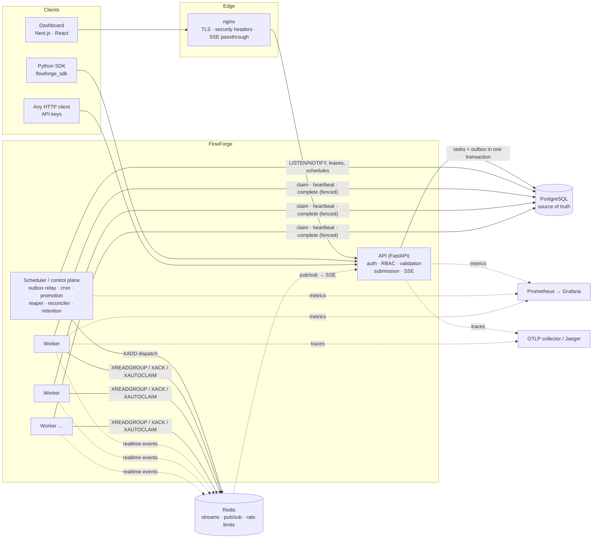
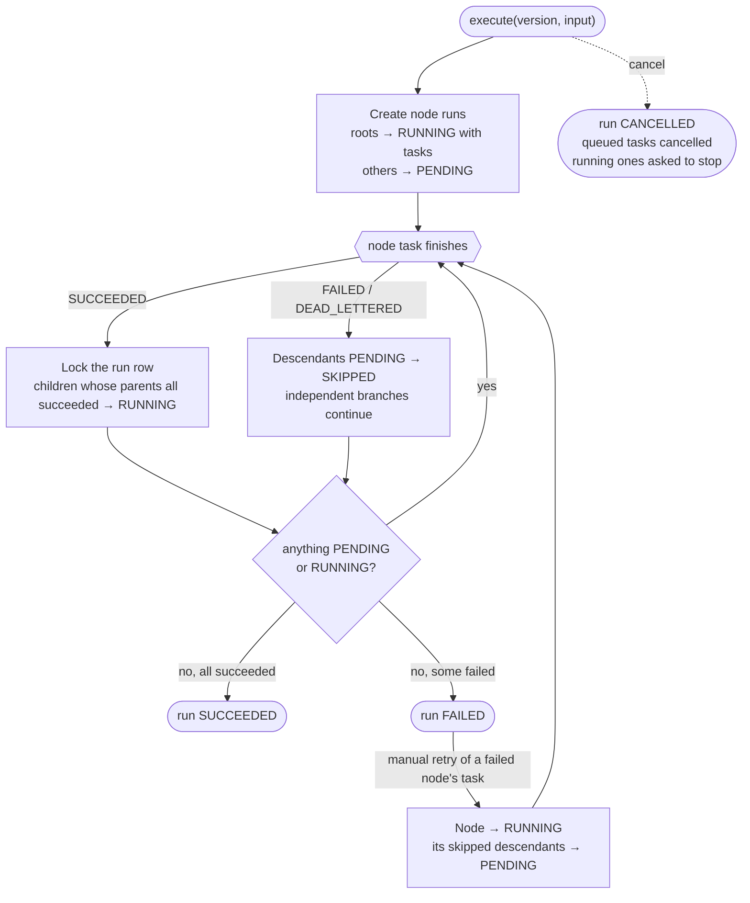
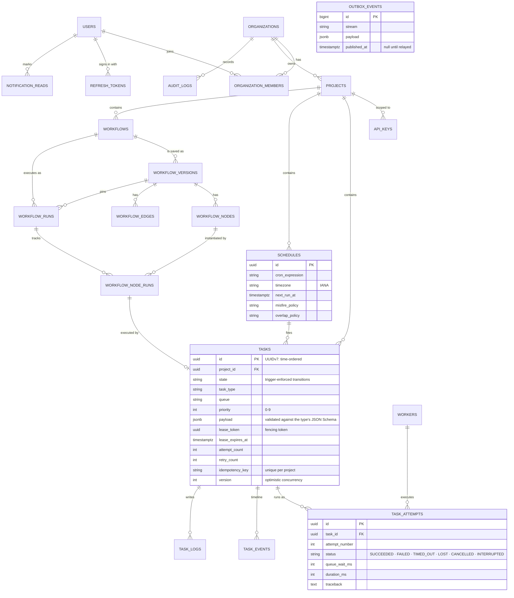

# Architecture

FlowForge is a modular monolith split into a few process types that share one PostgreSQL database and one Redis.
There are no microservices: every process imports the same domain packages (`flowforge_shared` for pure rules,
`flowforge_core` for persistence and services). Each process type scales horizontally.

## System



| Process | Responsibilities | Scaling |
|---|---|---|
| **API** (`flowforge-api`) | Authentication (JWT + rotating refresh cookie, API keys), RBAC and tenant isolation, payload validation against each task type's JSON Schema, submission (task + outbox row in one transaction), queries, SSE fan-out | Stateless; any number of replicas |
| **Worker** (`flowforge-worker`) | Reads its queues' streams by priority band, claims tasks with a fenced lease, runs handlers (asyncio, or a process pool for CPU-bound types), heartbeats, completion and failure, task logs, cooperative cancellation, graceful drain | Any number; each has `worker_concurrency` slots |
| **Scheduler** (`flowforge-scheduler`) | Outbox relay, promotion of delayed and retrying tasks, cron firing, lease reaper, offline-worker detection, reconciler, retention, queue metrics | Any number of replicas; work is partitioned with `FOR UPDATE SKIP LOCKED` |
| **Dashboard** (`apps/web`) | Glassmorphism UI over the public API; live updates through SSE | Static assets plus a Node server |

## Life of a task

```mermaid
sequenceDiagram
    autonumber
    participant C as Client
    participant API
    participant DB as PostgreSQL
    participant S as Scheduler
    participant R as Redis
    participant W as Worker
    C->>API: POST /api/v1/tasks (Idempotency-Key)
    API->>DB: BEGIN; INSERT task (QUEUED); INSERT outbox row; NOTIFY; COMMIT
    API-->>C: 201 task
    DB-->>S: NOTIFY outbox
    S->>DB: lock unpublished outbox rows (SKIP LOCKED)
    S->>R: XADD ff:q:default:normal {task_id, …}
    S->>DB: mark published; COMMIT
    W->>R: XREADGROUP (band order by weighted round-robin)
    W->>DB: UPDATE … SET state=RUNNING, lease_token WHERE state='QUEUED'
    W->>R: XACK
    W->>W: run handler (logs, progress, heartbeat renews lease)
    W->>DB: complete with lease_token (fenced) → SUCCEEDED, event
    W-)R: publish realtime event
    R-)API: pub/sub
    API-)C: SSE "task.updated" → dashboard refetches
```

Delayed tasks are created `SCHEDULED` and promoted to `QUEUED` (with their outbox row) by the scheduler when due.
Retries take the same path through `RETRY_SCHEDULED`. The full state machine, the recovery mechanisms and the failure
matrix are in [reliability.md](reliability.md).

## Priorities and queues

Each queue is three Redis streams (`high` for priority 7–9, `normal` for 4–6, `low` for 0–3). For every read, a
worker picks the band order with smooth weighted round-robin (weights 6/3/1). High-priority work is preferred, but
low-priority work is still read first about 10% of the time, so it can't starve. Workers subscribe to a set of queues
(`FLOWFORGE_WORKER_QUEUES`). Task types declare a default queue, priority, retries and timeout, and submissions may
override them.

## Workflows

A workflow is a versioned DAG of task-type steps, validated on save (no cycles, at most 200 nodes and 1,000 edges,
known task types, payloads valid for their type). A run pins its version.



A step's handler receives the run input and the results of its direct upstream steps
(`ctx.workflow_input`, `ctx.upstream`).

## Data model



Twenty-two tables in all; the diagram shows the relationships that matter, and `OUTBOX_EVENTS`, `TASK_TYPES` (the
catalog workers publish at start-up) and `WORKERS` have no tenant. Every tenant-owned row carries `project_id`, and
every query filters by the project resolved from the caller's credentials. A resource in another tenant answers
`404`, exactly like one that does not exist.

## Repository layout

```text
flowforge/
├── apps/
│   ├── api/                 FastAPI application (routers, schemas, middleware, SSE)
│   └── web/                 Next.js 16 dashboard
├── services/
│   ├── worker/              worker runtime, handler registry, demo and business handlers
│   └── scheduler/           control plane
├── packages/
│   ├── shared-schemas/      pure domain rules: states, retry math, DAG validation, cron, RBAC, OpenAPI document
│   ├── core/                settings, database models and migrations, services, broker, observability, admin CLI
│   └── python-sdk/          sync and async client
├── infrastructure/          Dockerfiles, nginx, Prometheus (with alerts), Grafana (provisioned dashboard)
├── tests/                   unit · integration · chaos · e2e (Playwright) · performance (benchmark harness)
├── docs/                    architecture · decisions (ADRs) · benchmarks · evaluation · deployment
└── scripts/                 native dev stack, demo seeding, OpenAPI export
```
