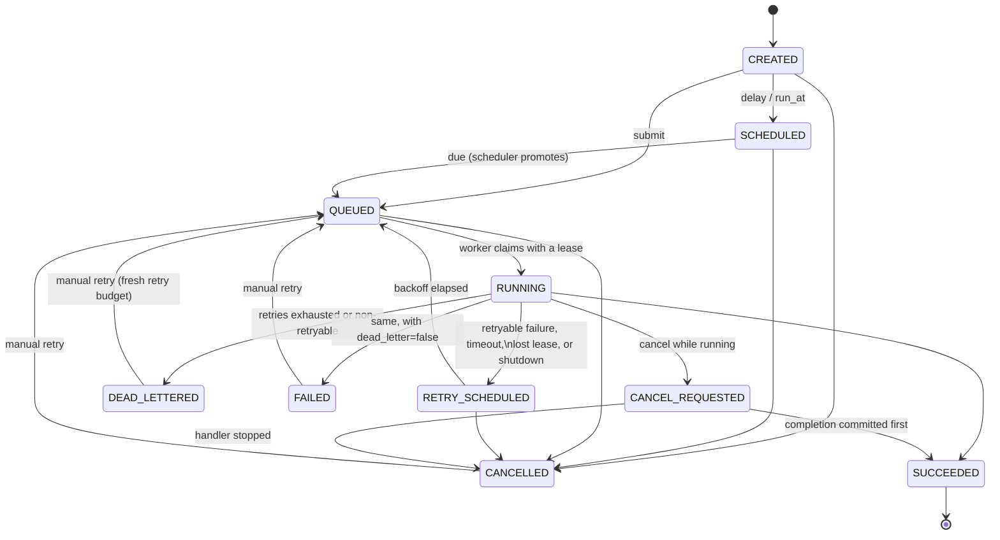
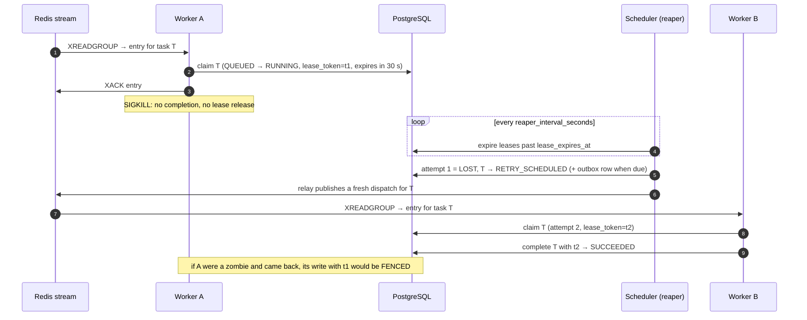

# Reliability model

FlowForge promises **at-least-once execution with exactly-once state transitions**. A task's handler may run more
than once when a failure hides the outcome of an earlier attempt (a worker crash after the side effect, a network
partition during completion), so handlers must be idempotent. In return, every task ends in exactly one terminal
state, records at most one successful attempt, and is never lost while PostgreSQL keeps its data.

FlowForge does **not** claim exactly-once execution. No queue can offer it for arbitrary side effects.

## Where the truth lives

| Store | Role | If it loses data |
|---|---|---|
| **PostgreSQL** | Source of truth: tasks, attempts, leases, events, schedules, workflow runs, outbox | Restore from backup; nothing else can rebuild it |
| **Redis Streams** | Dispatch channel only: "task X is ready" notifications per queue and priority band | Harmless: the reconciler re-dispatches every `QUEUED` task whose stream entry is gone |
| **Redis pub/sub** | Realtime fan-out to the dashboard (SSE) | Harmless: clients refetch from the API on reconnect |

## Task state machine

The transition table in `flowforge_shared/states.py` is enforced three times: in Python (`assert_transition`), in
every SQL update (`WHERE state IN (legal predecessors)`), and by a PostgreSQL trigger that rejects illegal changes
even from manual SQL. An integration test proves the trigger and the table agree for every pair of states.

## Mechanisms

**Transactional outbox.** A state change that needs a dispatch writes the outbox row in the same transaction. The
scheduler's relay publishes outbox rows to Redis (woken by `LISTEN/NOTIFY`, with polling as a fallback) and marks
them published. A crash between the publish and the commit publishes again, and the worker discards the duplicate
because the task is no longer `QUEUED`. A Redis outage leaves the rows unpublished until Redis returns.

**Claim and acknowledgement order.** A worker reads an entry, claims the task in PostgreSQL
(`UPDATE … WHERE state = 'QUEUED'`: exactly one claimer wins), and only then acknowledges the stream entry. If it
dies in between, the entry stays in the consumer group's pending list and another worker reclaims it with
`XAUTOCLAIM` after `worker_reclaim_min_idle_ms`.

**Leases with fencing tokens.** A claim sets `lease_owner`, a random `lease_token` and `lease_expires_at`. Heartbeats
renew the leases of running tasks. Every write from an attempt (progress, completion, failure) must present the
current token. A zombie attempt (a worker that was presumed dead but kept running) is rejected (`FENCED` event, metric
`flowforge_fenced_writes_total`) and cannot overwrite a newer attempt.

**Reaper.** The scheduler expires leases whose deadline has passed. The attempt is recorded as `LOST`, and the task
follows the normal failure policy (retry with backoff, or dead-letter). Workers that stop heartbeating are marked
`OFFLINE`.

**Reconciler.** When a queue band's stream holds no entries at all, but PostgreSQL still has `QUEUED` tasks for it
that are older than `reconcile_grace_seconds` and have no unpublished outbox row, those tasks are re-dispatched.
This covers Redis restarts without persistence. Because it waits for an empty stream, a *partial* loss (some entries
gone, others still there) is repaired once the remaining entries drain.

**Retries.** `delay = min(max, base × 2^(n−1))` with *equal jitter* (half fixed, half random), from the task's own
`retry_backoff_seconds` and `retry_backoff_max_seconds`. Only failures that are the task's fault consume a retry. A
graceful worker shutdown re-queues the task without consuming one (`INTERRUPTED`).

**Dead-letter queue.** Exhausted or non-retryable tasks become `DEAD_LETTERED` (or `FAILED` with
`dead_letter=false`). A manual retry grants a fresh retry budget and is audited.

**Idempotent submission.** `Idempotency-Key` (header or field) is unique per project. A replay returns the original
task, and reusing the key with a different request returns `409`.

**Cron schedules fire exactly once per fire time.** Each fire creates its task with the idempotency key
`schedule:<id>:<fire time>` and advances `next_run_at` in the same transaction, with the schedule row locked
(`FOR UPDATE SKIP LOCKED`). Any number of scheduler replicas can run, and killing one mid-transaction rolls back
cleanly. Misfires (missed while down) either run once to catch up or are skipped, as configured per schedule.

**Workflows.** Every progression step locks the run row first (lock order: run before task, everywhere), so two
parents finishing at once start a child exactly once. A partial unique index on `tasks.workflow_node_run_id` is a
second, database-level guarantee.

## Crash recovery

## Failure matrix

Each row is exercised by an automated test. The chaos tier (`tests/chaos`) uses real processes killed with SIGKILL
and real TCP partitions through a fault-injection proxy.

| Failure | What happens | Verified by |
|---|---|---|
| Worker killed mid-task | Lease expires, attempt `LOST`, task retried on another worker | `test_worker_killed_mid_task_is_recovered_by_another_worker` (chaos), `test_expired_lease_is_recovered_and_task_completes` |
| Worker dies after reading, before claiming | Entry stays pending and is reclaimed with `XAUTOCLAIM` | `test_pending_entry_of_crashed_consumer_is_reclaimed` |
| Claiming fails with an unexpected error (e.g. a bug in a release) | Entry stays pending and is retried on every reclaim; the task stays `QUEUED` with no attempt used. Counted in `flowforge_worker_handler_crashes_total` and alerted on (`FlowForgeWorkerHandlerCrashes`). Runs once the fix is deployed | `test_unexpected_claim_error_keeps_entry_pending_until_fixed` |
| Zombie worker writes after its lease was taken over | Write rejected (fenced) and audited as an event | `test_zombie_attempt_cannot_overwrite_new_attempt` |
| Redis unreachable | Submissions succeed (outbox), dispatch resumes on reconnect, nothing lost | `test_redis_partition_delays_but_loses_nothing` (chaos), `test_outbox_rows_survive_redis_outage` |
| Redis restarted without data | Reconciler re-dispatches from PostgreSQL | `test_redis_restart_without_data_is_repaired_by_reconciler` (chaos) |
| PostgreSQL unreachable | Workers retry claims and completions, stay up, and heal | `test_postgres_partition_heals_without_restarting_services` (chaos) |
| Duplicate stream entries | Second claim finds the task not `QUEUED` and discards it | `test_duplicate_stream_entries_execute_once` |
| Scheduler replicas, one killed mid-cycle | One task per fire time | `test_scheduler_replicas_fire_exactly_once_even_when_one_is_killed` (chaos), `test_concurrent_fires_create_exactly_one_task_per_fire_time` |
| Cancel and complete race | Exactly one wins, and the state is consistent | `test_concurrent_cancel_and_complete_are_consistent` |
| Graceful shutdown with running tasks | Tasks handed back without consuming a retry | `test_graceful_shutdown_releases_running_task_without_consuming_retry` |
| Two workers, one task | Only one claim succeeds | `test_two_workers_never_both_claim_the_same_task` |

## Limits

* **Handlers must be idempotent.** A handler that finished its side effect, then lost its worker before completion
  committed, runs again.
* **Lease length bounds detection time.** A task whose worker vanishes is retried after up to
  `lease_ttl_seconds` plus one reaper interval (30 s + 5 s by default), plus the first retry's backoff. Stream entries
  the worker had read but not yet claimed wait for `worker_reclaim_min_idle_ms` plus up to one reclaim interval
  (60 s + 15 s by default). The [performance report](../evaluation/performance-report.md) measures both under load.
  Lowering the reclaim idle time is safe, because only one claim of a task can succeed and other deliveries are
  discarded; the cost is more discarded deliveries when claims are slow. Long tasks keep their lease through
  heartbeats; a handler that blocks the event loop for longer than the lease will be presumed dead. CPU-bound
  handlers run in a process pool to avoid this.
* **PostgreSQL is a single point of truth.** Use a replicated PostgreSQL (streaming replication or a managed service)
  for availability, and back it up (see [deployment](../deployment.md)).
